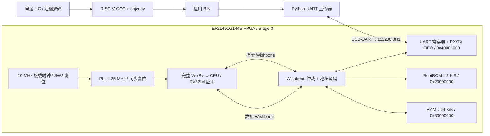

# RISC-V SoC：UART 加载、FreeRTOS 与独立 JTAG 调试

本项目在安路 **EF2L45LG144B** FPGA 上实现 VexRiscv、8 KiB BootROM、64 KiB RAM 和 UART。电脑把 C 程序编译成 RISC-V BIN，经串口下载到 RAM；CPU 校验完成后跳到应用执行。修改应用只需重新编译和上传软件，无需重新综合 FPGA 硬件。

当前主线是 **Stage 3**。2026-10-13 实板已验证两份 42424 字节应用的下载、CRC32、RAM 执行和 newlib `printf/snprintf`，包括 `FLOAT=3.25`、`errors=0`、`STAGE3 PASS`。完整记录见 [实板验收](docs/stage3/HARDWARE_VALIDATION.md)。Stage 1/2 保留为历史实验，不能把它们的小容量参数当成当前系统参数。

**最新完成：FreeRTOS V11.1.0 已于 2026-10-15 在真实 FPGA 上运行。** 新 `stage3_rtos_top` 加入 CLINT 定时器/软件中断和精简 PLIC，1000 Hz tick 驱动抢占式任务调度；寄存器保存、嵌套临界区、队列、ISR 通知和真实 UART 中断均通过，三次后续心跳持续增长。TD 25 MHz 时序 0 setup/hold。通过原 BootROM + UART 下载 15544B BIN，不需要独立 JTAG 调试器。原理、构建和实板证据见 [FreeRTOS](docs/stage3/FREERTOS.md)。

**独立 RISC-V JTAG 仍等待调试器，未实板验收。** CPU 自带 TAP 接 FPGA 普通 I/O，不经过安路用户扫描链。真实 RTL + 标准 OpenOCD/GDB 仿真已通过完整 64 KiB RAM 下载/回读、ELF、单步、C 断点和变量检查；TD 时序 0 setup/hold。UART-only、独立 JTAG 和 RTOS 使用各自的 CPU/位流，当前 RTOS 位流不包含独立 JTAG。详情见 [JTAG 调试](docs/stage3/JTAG_DEBUG.md)。

## SoC 架构

下图为 UART 基础系统。RTOS 版本在相同 Wishbone 上增加 CLINT（`0x02000000`）、PLIC（`0x0c000000`）和测试事件寄存器（`0x40002000`），并把定时、软件、外部 IRQ 接入 CPU；完整中断路径见 FreeRTOS 文档。



CPU 复位从 BootROM 取指。BootROM 通过 UART 接收 BIN，经 Wishbone 写入 RAM，验证 CRC32 后跳到 `0x80000000`。应用的 `printf` 通过 `_write` 访问同一个 UART。仲裁器同时连接指令、数据两个主端口，并在一次总线周期内保持归属，避免取指缓存的突发传输被打断。未知地址和 ROM 写入返回总线错误。

**AL-Link Mini** 用于配置 FPGA 位流，不在 UART 应用下载路径中。新的 `stage3_debug_top` 使用 CPU 自带标准 JTAG + 独立调试器，其下载路径为 TAP/DTM -> DMI/DM -> Program Buffer -> CPU 数据 Wishbone -> RAM。Stage 2 私有 69 位 JTAG 加载器和安路用户扫描链问题仅为历史记录，不是当前方案。

| 地址范围 | 大小与用途 |
| --- | --- |
| `0x20000000..0x20001fff` | 8 KiB BootROM，复位入口；由 FPGA 位流初始化，只读 |
| `0x80000000..0x8000efff` | 60 KiB 应用、数据、BSS、堆及测试区；BIN 最大 61440 字节 |
| `0x8000f000..0x8000ffff` | RAM 顶部 4 KiB 栈，初始 SP 为 `0x80010000` |
| `0x40001000..0x40001fff` | UART 地址窗口，实际寄存器见 `rtl/common/uart_wb.v` |

UART-only 测试应用还保留 `0x8000b800..0x8000efff` 作为 14 KiB RAM 测试区，见 `fw/stage3/app.ld`。RTOS 使用独立 `fw/rtos/app.ld`，不保留该测试区：代码、BSS（含 16 KiB 内核堆）位于低 60 KiB，顶部 4 KiB 是主程序/ISR 栈，任务栈从内核堆分配。BIN 尺寸合规不代表任意 C 程序的运行时内存都合规；扩展应用时需检查代码、BSS、堆与栈的布局。RAM 不保存断电后的程序，项目未实现 Flash 持久化启动。

## 目录

```text
RISC-V-SoC/
|-- rtl/                  Verilog 电路源码
|   |-- common/           UART、FIFO、自定义 JTAG 原型
|   |-- cpu/              完整 CPU 的 Scala 生成配置、来源与许可证
|   |-- ip/               PLL 设计输入
|   |-- stage1/           最初的精简指令集实验
|   |-- stage2/           1 KiB ROM / RAM 历史版本
|   `-- stage3/           当前 SoC 与 BRAM 存储实现
|-- fw/                   C、汇编与链接脚本
|   |-- common/           共用启动汇编
|   |-- stage2/           小容量启动与演示程序
|   |-- stage3/           BootROM、newlib 应用及系统调用
|   `-- rtos/             FreeRTOS 配置、多任务示例和链接布局
|-- tb/                   Verilog testbench 和 Python 单元测试
|-- script/               构建、产物检查、仿真、UART 上传和 TD Tcl
|-- constraints/          引脚 / 时序 / 历史 ChipWatcher 约束
|-- docs/                 中文报告和分阶段验收记录
|-- requirements.txt      Python 依赖
|-- agent.md              当前进度与接手说明
`-- build/                本地生成文件，由 .gitignore 排除
```

Git 只跟踪源码、脚本、设计约束和文档。ELF、BIN、HEX、位流、TD 工程/数据库、仿真结果、日志和 Python 缓存不提交。整理前的产物保留在本地 `build/`；新克隆需要重新生成。TD 工程由 `script/prepare_td_project.py` 从源文件生成，不依赖旧的综合运行目录。

## 环境准备

使用 Windows PowerShell 7、Python 3.10+、RISC-V GCC（含 newlib nano）、Icarus Verilog 和安路 TangDynasty 5.6。已验证的交叉工具链为 xPack `riscv-none-elf-gcc 15.2.0-1`，应用编译参数为 `-march=rv32im -mabi=ilp32`。

Stage 2/3 依赖完整的 VexRiscv Wishbone CPU RTL，**不是** `rtl/stage1/VexRiscv.v` 中的精简实验 CPU。CPU RTL 是外部生成输入，不随本仓库的构建产物提交；需提供当前工程配套的 `VexRiscv.v`，其端口包括 `externalResetVector`、指令和数据 Wishbone 接口。CPU 的不同生成配置不能随意互换。

配套生成配置及已验证 RTL 的固定版本、下载步骤和 SHA256 见 [CPU 来源](rtl/cpu/README.md)。生成的 `VexRiscv.v` 放在本地 `build/cpu/`，通过 `VEXRISCV_SOURCE` 指向它。

本机脚本保留已安装工具的默认路径，其他电脑可用环境变量覆盖。以下是本机对应值，从仓库根目录运行：

```powershell
python -m pip install -r requirements.txt
$env:RISCV_TOOLCHAIN = 'D:\risc-v\toolchain\xpack-riscv-none-elf-gcc-15.2.0-1\bin'
$env:VEXRISCV_SOURCE = 'D:\fpga-3-softcores-master\vendor\vexriscv\VexRiscv.v'
$env:TD_EXECUTABLE = 'D:\TD_5.6.5_Release_119.222\bin\td_commands_prompt.exe'
$env:EF2_MACRO_SOURCE = 'D:\TD_5.6.5_Release_119.222\arch\ef2_macro.v'
$env:IVERILOG = 'D:\risc-v\simulator\ucrt64\bin\iverilog.exe'
$env:VVP = 'D:\risc-v\simulator\ucrt64\bin\vvp.exe'
```

`SOC_PYTHON` 可指定 Python 可执行文件；默认用 PATH 中的 `python`。Python 上传依赖只有 `pyserial==3.5`。厂商 BRAM 功能模型从安装的 `ef2_macro.v` 端口定义生成，用于逻辑验证，不替代厂商时序模型。

## 构建与验证

先做不接触硬件的检查：

```powershell
.\script\build_stage3_firmware.ps1
python .\script\verify_stage3_artifacts.py
python .\script\run_tests.py
.\script\run_stage3_sim.ps1 -Test memory
.\script\build_stage3_td.ps1 -PrepareOnly
```

输出在 `build/stage3/`。固件构建生成 BootROM、app A、app B 的 ELF/BIN/Intel HEX、ROM INIT 和 UART 仿真帧；检查脚本比较各格式内容、入口、BSS、栈及 libc 符号。`memory` 仿真覆盖完整 8 KiB ROM、64 KiB RAM、16 种字节使能、bank 边界和复位。

生成 FPGA 位流：

```powershell
.\script\build_stage3_td.ps1
```

脚本执行综合、布局布线和时序检查，报告须为 0 setup/hold 错误。输出为 `build/stage3/stage3_uart.bit`。时序通过与实板功能通过是两项不同的验证。

可选 `run_stage3_sim.ps1 -Test smoke`（真实波特率短程序）及 `-Test uart`（仿真加速后两份完整程序）运行时间较长；旧记录中的这两项未完成，不计作已通过。历史 Stage 2 入口为 `build_stage2_firmware.ps1`、`build_stage2_td.ps1`、`run_stage2_sim.ps1`、`run_stage2_jtag_sim.ps1`。Stage 1 使用 `build_td.ps1`。

2026-10-14 在不含旧产物的源码副本中重新验证：26 项 Python 测试通过；Stage 2/3 固件可重建，Stage 3 BIN 与实板版本哈希相同；完整 ROM/RAM 仿真、JTAG 加载器及 Stage 2 JTAG SoC 仿真通过；Stage 3 UART testbench 编译通过；TD 完成 Stage 3 综合、布局布线及位流生成，setup/hold 错误均为 0。本轮没有重新板测，也没有把两项长 UART 仿真计作通过。

## 实板操作

本节是已验证的 **UART-only 位流**操作；独立 JTAG 新位流的接线和待实板验证命令见 [JTAG 调试](docs/stage3/JTAG_DEBUG.md)，两种 CPU 生成输入和位流不能互换。

板卡 RX=P59、TX=P60、复位=P55，USB-UART 使用 3.3 V 电平并共地。串口参数为 115200、8N1、无流控，先关闭占用端口的 Tera Term；本机端口为 COM3，其他电脑按实际端口修改。

终端一先监听，等待新一次 BootROM 横幅：

```powershell
python .\script\uart_upload_stage3.py .\build\stage3\app_a.bin --port COM3 --boot-timeout 180 --expect-text 'STAGE3 PASS'
```

终端二配置 FPGA 易失性逻辑，使 CPU 进入 BootROM：

```powershell
& $env:TD_EXECUTABLE .\script\configure_stage3_fpga.tcl
```

成功后可看到 `APP 1`、`FLOAT=3.25`、`errors=0`、`STAGE3 PASS`。再复位并上传 `app_b.bin`，应输出 `APP 2`。已有 Stage 3 实板记录每次通过相同位流重新配置来复位；仅按 SW2 换载尚待单独补测。上述 Tcl 不烧写 Flash。

BootROM 横幅为 `BOOT UART 64K\r\n`。协议头是 `RV32`、小端 32 位长度、入口 `0x80000000`、CRC32，再跟 4 字节对齐的 BIN。每字节回 `A`，头有效回 `H`，CRC 正确回 `G` 并跳转，拒绝回 `E`。只上传 `.bin`；ELF 用于链接检查，Intel HEX 用于产物比较，二者不由 BootROM 解析。

## 验证记录与资料

- [Stage 3 详细流程](docs/stage3/README.md)
- [FreeRTOS 实板运行](docs/stage3/FREERTOS.md)：定时器、中断控制器、抢占/队列、UART 验收和复现
- [独立 RISC-V JTAG 调试](docs/stage3/JTAG_DEBUG.md)：原理、完整 RAM 仿真、GDB、H3 接线和实板待验收
- [实板验收与边界](docs/stage3/HARDWARE_VALIDATION.md)：两份应用、六类错误帧和恢复执行
- [中文原理报告与答辩准备](docs/report.md)
- [当前进度](agent.md)
- [Stage 2 历史](docs/stage2/README.md) 与 [ChipWatcher 问题](docs/stage2/CHIPWATCHER_TIMING.md)

尚未单独实测最大 60 KiB BIN、Stage 3 仅 SW2 换载或实板全地址穷举。自定义 JTAG 用户链路和 ChipWatcher 时序问题仍属历史未完成扩展；禁用入口继续保持禁用。生成日志只保留本地，文档记录已有验收结果及其限制。
