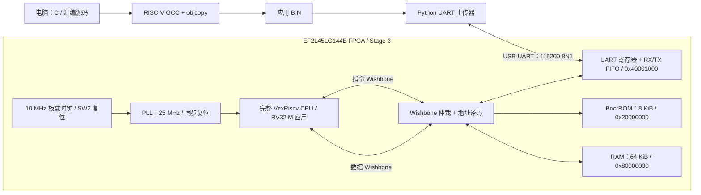

# RISC-V SoC：UART 加载、FreeRTOS 与独立 JTAG 调试

**当前实板状态（2026-10-23）：** 合并版完整 JTAG/GDB 回归、三次板载 Type-C 断电冷启动，以及重插 Type-C 后的 10 分钟连续运行均通过。三次冷启动各自捕获 BootROM、FreeRTOS 自检、UART IRQ 和三条递增心跳；最后一次上电后的 120 秒观察也通过。用户确认外接 IoTelic CPU JTAG 已从板端取下，期间未用 TD 下载。PotatoPie V3.0 的 AL-Link Mini 是**板载**下载器，不能把这一条件写成“板上没有任何调试器”。此前 Type-C/USB 间歇失联和串口零字节的失败记录保留；重插后只读 FPGA ID、冷启动和十分钟观察均通过。长期可靠性和 USB 失联根因仍需更长时间观察。详见 [合并实验](docs/stage3/UNIFIED.md)。

本项目在安路 **EF2L45LG144B** FPGA 上实现 VexRiscv、8 KiB BootROM、64 KiB RAM 和 UART。电脑把 C 程序编译成 RISC-V BIN，经串口下载到 RAM；CPU 校验完成后跳到应用执行。修改应用只需重新编译和上传软件，无需重新综合 FPGA 硬件。

当前主线是 **Stage 3**。2026-10-13 实板已验证两份 42424 字节应用的下载、CRC32、RAM 执行和 newlib `printf/snprintf`，包括 `FLOAT=3.25`、`errors=0`、`STAGE3 PASS`。完整记录见 [实板验收](docs/stage3/HARDWARE_VALIDATION.md)。Stage 1/2 保留为历史实验，不能把它们的小容量参数当成当前系统参数。

**FreeRTOS V11.1.0 已于 2026-10-15 在真实 FPGA 上运行。** 新 `stage3_rtos_top` 加入 CLINT 定时器/软件中断和精简 PLIC，1000 Hz tick 驱动抢占式任务调度；寄存器保存、嵌套临界区、队列、ISR 通知和真实 UART 中断均通过，三次后续心跳持续增长。TD 25 MHz 时序 0 setup/hold。通过原 BootROM + UART 下载 15544B BIN，不需要独立 JTAG 调试器。原理、构建和实板证据见 [FreeRTOS](docs/stage3/FREERTOS.md)。

**合并实验（配置 Flash 已更新，上电后 FreeRTOS 持续运行）：** 同一颗候选 CPU 集成 FreeRTOS 中断/CSR、4 KiB 单路指令缓存和独立 CPU JTAG，并接上 Flash XIP、写控制器与 RTOS 外设。TD 布局为 **1105/1120 mslice**，25 MHz 时序 0 setup/hold 违例。15908 B FreeRTOS XIP 镜像已持久写入 MCU 用户区物理 `0x50000..0x53fff`；合并位流也已持久烧入配置 Flash，TD `verify_spi` 和写前/后各两次整片 512 KiB 读回通过，MCU 用户区 0 字节变化。预先开启 COM3 监听后重上电，同一次监听捕获 `BOOT FLASH`、FreeRTOS 启动、UART IRQ、自检通过和三次递增心跳。CPU JTAG 已读到 TAP `0x10002fff` 和外设标识，完成合并版全 64 KiB RAM/GDB 实板回归；板载 Type-C 重插后又完成三次冷启动验收。用户确认板端外接 CPU JTAG 已取下，期间未用 TD 下载；板载 AL-Link 仍在板上。详见 [合并实验](docs/stage3/UNIFIED.md)。

同日 COM3 持续运行验收观察到 588 条递增心跳，覆盖约 600 秒，最大间隔 1.038 秒，未见重启。独立 IoTelic CPU JTAG 在持久合并系统上完成 RAM/寄存器/单步/断点、GDB ELF 与 C 源码、全 65536 字节图案下载和逐字节读回、换码缓存一致性；报告 `full_suite_passed=true`，复位后 COM3 再次看到 BootROM、FreeRTOS 自检与心跳。后来三次板载 Type-C 断电冷启动均通过；此前间歇失联的原因尚未完全定位，仍需更长周期观察。

**合并 RTL 仿真超时已定位并处理：** 完整 15908 B 镜像的 BootROM CRC 是长时间 CPU 软件循环，`script/run_unified_modelsim.ps1` 用 ModelSim 10.1c 复跑全长 CRC、XIP 和 FreeRTOS 自检通过（约 391 秒）；`script/run_unified_sim.ps1 -Test jtag-bootrom` 用不改应用字节的仿真专用 64 字节 CRC 前缀，在单次 Icarus RTL 运行中完成 BootROM、FreeRTOS 自检和 OpenOCD JTAG 暂停/单步/硬件断点。后者**不代表全镜像 CRC 已在同一次运行中检查**；生产 `.xip` 和实板 Flash 未改。见 [合并实验](docs/stage3/UNIFIED.md)。

**独立 RISC-V JTAG 已于 2026-10-18 在独立调试位流上完整实板通过，并于 2026-10-23 在合并位流上复测通过。** IoTelic FT2232HL + OpenOCD/GDB 在 100 kHz 下完成全 64 KiB 下载/逐字节读回、ELF、指令/源码单步、软硬件断点、变量检查、复位保留 RAM 和换代码后缓存一致性。CPU 自带 TAP 接 FPGA 普通 I/O，不经过安路用户扫描链；AL-Link 配置 FPGA，独立 CPU JTAG 调试运行中的 SoC。旧位流报告与合并版报告分别保留，后者还验证了复位回 XIP FreeRTOS 启动与心跳；证据和复现见 [JTAG 调试](docs/stage3/JTAG_DEBUG.md)及[合并实验](docs/stage3/UNIFIED.md)。

**Flash 上电启动状态（2026-10-20）：位流与 XIP 应用已写入片内 Flash；用户确认开发板断电重上电且未用 TD 下载位流后，CPU JTAG 证实 XIP 应用仍在运行。** 原有 UART/RTOS/JTAG 变体仍是独立工程，不应把它们的 SRAM 下载结果当作本变体的持久启动证据。

独立 Flash/XIP 变体将片内 512 KiB Flash 映射到 `0x30000000`，复用 CPU 的 4 KiB、1-way 指令缓存。TD 的 `program_spi` 将 259,359 字节位流写入配置区，`program_spibin` 将 192 字节应用写入物理 `0x50000`；写前/写后整片读回确认应用写入只改变这 192 字节。临时将该位流配置到 FPGA SRAM 后，实板 COM3 输出 `BOOT FLASH` 和 `HELLO,YUAN!`；JTAG 观察到缓存重新填充后命中。随后用户确认只给开发板断电重上电、未用 TD 下载位流；OpenOCD 读到 CPU TAP `0x10002fff`，PC 为 `0x3005009c`，应用循环计数在 1 秒内从 `0x350c71a` 增至 `0x364a82a`。这支持片内 Flash 上电装载与 XIP 运行；此次调试线仍连接，启动瞬间的 COM3 字符未捕获，完全脱离调试线的独立上电尚未测试。详见 [Flash XIP](docs/stage3/FLASH_XIP.md)。

Flash 单启动分区为：物理 `0x00000..0x4FFFF` 的 **320 KiB 配置预留区**，物理 `0x50000..0x7FFFF` 的 **192 KiB MCU 用户区**。此前实板位流实际占用至 `0x3ED0E`，应用位于 `0x50000..0x500BF`；后 128 KiB 暂未分配。不考虑 Multi Boot。新增的 SPI 写控制器挂在 `0x40004000`，MCU 可对用户区做 4 KiB 扇区擦除和单字节编程；配置区在硬件中拒绝擦写。2026-10-21 RAM 中的真实 MCU 固件在实板物理 `0x60000` 擦除并写入 `MCU!`。**2026-10-22 新版写控制器位流已通过 TD 持久烧入配置 Flash，`verify_spi` 通过；烧写前后整片双读比较表明 MCU 用户区 0 字节变化。用户随后只重上电开发板且未用 TD 下载，CPU JTAG 读到 XIP 区 PC 和增长的循环计数，支持新版配置从 Flash 自动加载并运行。调试线仍连接，完全脱离调试器的上电未测。**详见 [Flash 分区与写控制器](docs/stage3/FLASH_XIP.md#单启动分区不考虑-multi-boot)。

**写入速度优化（2026-10-22，实板测试扇区通过）：** 在保留旧单字节命令的同时，新增最多 16 字节的 SPI 页编程批量事务；C 驱动与 OpenOCD 脚本通过状态位识别新硬件，旧位流自动回退单字节路径。RTL、RV32 整机仿真及 83 项主机测试通过；TD 新位流 4104/4480 LUT、10/12 BRAM，0 setup/hold 违例。新位流 SHA256 `152cadf20cb9390ee75a1a55fc4d85b414fa1d74dfba61b7a8a7f7a1e69a8f81` 已**仅配置到 FPGA SRAM**，硬件状态 bit7 为 1；在物理 `0x60010` 写同一份 192 字节测试镜像，OpenOCD 写入阶段逐字节模式 33.663 秒、16 字节批量模式 11.213 秒，约快 3.0 倍。测试扇区已恢复，写前写后两份双读 512 KiB 备份逐字节相同。配置 Flash 中仍是上一版位流（SHA256 `b2f7d1af3921d31cbd961d2c43b44aa0cd6ab3fdafe03d602c33358ed6233078`）；掉电后不会自动保留这次批量写优化，且本次未重测完整 XIP 冷启动。详见 [实测与限制](docs/stage3/FLASH_XIP.md#16-字节批量页编程实板测速)。

新增的 [OpenOCD 烧录脚本](script/openocd/program-user-flash.tcl) 可通过独立 CPU JTAG 将原始二进制镜像写入 MCU 用户区，默认只读规划、逐扇区备份，显式确认后才擦写并读回校验。2026-10-21 实板先在物理 `0x60004..0x60007` 写入 `JTAG`，再经 OpenOCD 擦除 `0x60000..0x60fff`、恢复原有 `MCU!` 并移除 `JTAG`；两条路径均通过扇区读回。恢复后八次 64 KiB 分段只读覆盖整片 512 KiB，与写入前备份逐字节相同。单次连续全片 JTAG 读取曾报错或超时，不能把其 `.partial` 文件当作有效备份。该脚本不烧录 FPGA 配置位流；操作与保护边界见 [Flash XIP 说明](docs/stage3/FLASH_XIP.md#通过-openocd-的-cpu-jtag-烧录-mcu-用户区)。

整片只读备份入口 [backup_flash_readonly.ps1](script/backup_flash_readonly.ps1) 现自动分成八个 64 KiB 段，每段用独立 OpenOCD 会话读两次并逐字节比较；失败可重试，但错误日志、短文件或双读不一致都不会发布正式 `.bin`。先用 `-PlanOnly` 查看计划。新工具已在实板完成 16 次读取，结果与此前整片基线完全相同；命令和限制见 [Flash XIP 说明](docs/stage3/FLASH_XIP.md)。

**XIP 应用已真正更新为 V2（2026-10-22）：** 新程序输出 `HELLO,YUAN! XIP V2`，而非重复烧录旧镜像。写前双读备份整片 512 KiB，检查旧 `XIP1` 头/CRC 与目标扇区，保存完整 4 KiB 恢复文件；OpenOCD 只擦写物理 `0x50000..0x50FFF`，写后扇区读回及整片双读与计划逐字节一致（全片只有 20 字节变化）。CPU JTAG `reset run` 后 COM3 收到 `BOOT FLASH` 和完整 V2 文字。用户随后报告开发板断电重上电；只读 JTAG 看到持久旧版位流状态、V2 应用扇区哈希匹配和 XIP 循环持续运行。上电瞬间 COM3 未同步捕获，调试线仍连接。**16 字节写控制器位流没有持久烧写，重上电后已回到旧版**；单槽应用更新仍非断电原子操作。详见 [XIP 更新实测和恢复步骤](docs/stage3/FLASH_XIP.md#xip-应用-v2-更新与恢复)。

## SoC 架构

下图为 UART 基础系统。RTOS 版本在相同 Wishbone 上增加 CLINT（`0x02000000`）、PLIC（`0x0c000000`）和测试事件寄存器（`0x40002000`），并把定时、软件、外部 IRQ 接入 CPU；完整中断路径见 FreeRTOS 文档。



在已验证的 UART-only 变体中，CPU 复位从 BootROM 取指。BootROM 通过 UART 接收 BIN，经 Wishbone 写入 RAM，验证 CRC32 后跳到 `0x80000000`。应用的 `printf` 通过 `_write` 访问同一个 UART。仲裁器同时连接指令、数据两个主端口，并在一次总线周期内保持归属，避免取指缓存的突发传输被打断。未知地址和 ROM 写入返回总线错误。Flash 变体另有只读 Flash 窗口与 XIP 启动判断，见专门文档。

**AL-Link Mini** 用于配置 FPGA 位流，不在 UART 应用下载路径中。新的 `stage3_debug_top` 使用 CPU 自带标准 JTAG + 独立调试器，其下载路径为 TAP/DTM -> DMI/DM -> Program Buffer -> CPU 数据 Wishbone -> RAM。Stage 2 私有 69 位 JTAG 加载器和安路用户扫描链问题仅为历史记录，不是当前方案。

| 地址范围 | 大小与用途 |
| --- | --- |
| `0x20000000..0x20001fff` | 8 KiB BootROM，复位入口；由 FPGA 位流初始化，只读 |
| `0x80000000..0x8000efff` | 60 KiB 应用、数据、BSS、堆及测试区；BIN 最大 61440 字节 |
| `0x8000f000..0x8000ffff` | RAM 顶部 4 KiB 栈，初始 SP 为 `0x80010000` |
| `0x40001000..0x40001fff` | UART 地址窗口，实际寄存器见 `rtl/common/uart_wb.v` |

UART-only 测试应用还保留 `0x8000b800..0x8000efff` 作为 14 KiB RAM 测试区，见 `fw/stage3/app.ld`。RTOS 使用独立 `fw/rtos/app.ld`，不保留该测试区：代码、BSS（含 16 KiB 内核堆）位于低 60 KiB，顶部 4 KiB 是主程序/ISR 栈，任务栈从内核堆分配。BIN 尺寸合规不代表任意 C 程序的运行时内存都合规；扩展应用时需检查代码、BSS、堆与栈的布局。RAM 不保存断电后的程序；**独立 Flash/XIP 变体**已实现位流和演示应用持久化，不能把它等同于 UART/RTOS 应用掉电保存。

## 目录

```text
RISC-V-SoC/
|-- rtl/                  Verilog 电路源码
|   |-- common/           UART、FIFO、自定义 JTAG 原型
|   |-- cpu/              完整 CPU 的 Scala 生成配置、来源与许可证
|   |-- ip/               PLL 设计输入
|   |-- stage1/           最初的精简指令集实验
|   |-- stage2/           1 KiB ROM / RAM 历史版本
|   `-- stage3/           当前 SoC 与 BRAM 存储实现
|-- fw/                   C、汇编与链接脚本
|   |-- common/           共用启动汇编
|   |-- stage2/           小容量启动与演示程序
|   |-- stage3/           BootROM、newlib 应用及系统调用
|   |-- rtos/             FreeRTOS 配置、多任务示例和链接布局
|   `-- flash/            Flash BootROM、XIP 演示及链接布局
|-- tb/                   Verilog testbench 和 Python 单元测试
|-- script/               构建、产物检查、仿真、UART 上传和 TD Tcl
|-- constraints/          引脚 / 时序 / 历史 ChipWatcher 约束
|-- docs/                 中文报告和分阶段验收记录
|-- requirements.txt      Python 依赖
|-- AGENTS.md             后续工作方向与安全边界
`-- build/                本地生成文件，由 .gitignore 排除
```

Git 只跟踪源码、脚本、设计约束和文档。ELF、BIN、HEX、位流、TD 工程/数据库、仿真结果、日志和 Python 缓存不提交。整理前的产物保留在本地 `build/`；新克隆需要重新生成。TD 工程由 `script/prepare_td_project.py` 从源文件生成，不依赖旧的综合运行目录。

## 环境准备

使用 Windows PowerShell 7、Python 3.10+、RISC-V GCC（含 newlib nano）、Icarus Verilog 和安路 TangDynasty 5.6。已验证的交叉工具链为 xPack `riscv-none-elf-gcc 15.2.0-1`，应用编译参数为 `-march=rv32im -mabi=ilp32`。

Stage 2/3 依赖完整的 VexRiscv Wishbone CPU RTL，**不是** `rtl/stage1/VexRiscv.v` 中的精简实验 CPU。CPU RTL 是外部生成输入，不随本仓库的构建产物提交；需提供当前工程配套的 `VexRiscv.v`，其端口包括 `externalResetVector`、指令和数据 Wishbone 接口。CPU 的不同生成配置不能随意互换。

配套生成配置及已验证 RTL 的固定版本、下载步骤和 SHA256 见 [CPU 来源](rtl/cpu/README.md)。生成的 `VexRiscv.v` 放在本地 `build/cpu/`，通过 `VEXRISCV_SOURCE` 指向它。

本机脚本保留已安装工具的默认路径，其他电脑可用环境变量覆盖。以下是本机对应值，从仓库根目录运行：

```powershell
python -m pip install -r requirements.txt
$env:RISCV_TOOLCHAIN = 'D:\risc-v\toolchain\xpack-riscv-none-elf-gcc-15.2.0-1\bin'
$env:VEXRISCV_SOURCE = 'D:\fpga-3-softcores-master\vendor\vexriscv\VexRiscv.v'
$env:TD_EXECUTABLE = 'D:\TD_5.6.5_Release_119.222\bin\td_commands_prompt.exe'
$env:EF2_MACRO_SOURCE = 'D:\TD_5.6.5_Release_119.222\arch\ef2_macro.v'
$env:IVERILOG = 'D:\risc-v\simulator\ucrt64\bin\iverilog.exe'
$env:VVP = 'D:\risc-v\simulator\ucrt64\bin\vvp.exe'
```

`SOC_PYTHON` 可指定 Python 可执行文件；默认用 PATH 中的 `python`。Python 上传依赖只有 `pyserial==3.5`。厂商 BRAM 功能模型从安装的 `ef2_macro.v` 端口定义生成，用于逻辑验证，不替代厂商时序模型。

Flash/XIP 离线原型的复现顺序（不接触板上 Flash）：

```powershell
.\script\build_flash_firmware.ps1
.\script\run_flash_sim.ps1
.\script\run_flash_jtag_sim.ps1
.\script\build_flash_td.ps1
```

生成物在本地 `build/flash/`，不提交到 GitHub。`script/configure_flash_fpga.tcl` 仍只配置易失性 SRAM；持久烧写已通过 TD 的 `program_spi`（位流）与 `program_spibin`（应用）完成，应用槽始于物理 `0x50000`。开发板断电重上电后、未用 TD 下载位流的 XIP 运行已由 CPU JTAG 验证；完全脱离调试线的上电仍待测试，详见 [Flash XIP](docs/stage3/FLASH_XIP.md)。

烧写前的两份 CPU JTAG 与一份 TD 全片备份逐字节一致，SHA256 `3a60a97c00ade9b34a6834f52b016476252d5ea5bdf2940ef7c8e5c3cede00cf`。位流写后 TD 备份 SHA256 为 `72f24b2f0227e5854d033afefb711f431169674a0a95788997b7c169b1d5b20a`，应用写后为 `f4747274c3ec9773d4e3ce7d60c5179357d95cb50cf56c9382c32a9a2ede925c`；比较器确认第二次只改变目标 192 字节。TD 在 `persist_bit=0` 位流运行时会读到误导性的全 `FF`，因此每次原生读回前均临时配置普通调试位流到 SRAM。备份在本地 `build/flash/backups/`，不提交到 GitHub。

## 构建与验证

先做不接触硬件的检查：

```powershell
.\script\build_stage3_firmware.ps1
python .\script\verify_stage3_artifacts.py
python .\script\run_tests.py
.\script\run_stage3_sim.ps1 -Test memory
.\script\build_stage3_td.ps1 -PrepareOnly
```

输出在 `build/stage3/`。固件构建生成 BootROM、app A、app B 的 ELF/BIN/Intel HEX、ROM INIT 和 UART 仿真帧；检查脚本比较各格式内容、入口、BSS、栈及 libc 符号。`memory` 仿真覆盖完整 8 KiB ROM、64 KiB RAM、16 种字节使能、bank 边界和复位。

生成 FPGA 位流：

```powershell
.\script\build_stage3_td.ps1
```

脚本执行综合、布局布线和时序检查，报告须为 0 setup/hold 错误。输出为 `build/stage3/stage3_uart.bit`。时序通过与实板功能通过是两项不同的验证。

可选 `run_stage3_sim.ps1 -Test smoke`（真实波特率短程序）、`-Test boundary-header`（零长、未对齐、超限、错误入口/魔数及坏 CRC 拒收；恰好 61440B 的头被接收；最小 4 字节镜像从 RAM 取指，复位后正常重载）、`-Test uart`（仿真加速后两份完整程序）及 `-Test boundary`（先做上述边界检查，再做最大 61440B 上传、RAM 末字检查和复位重载）。`boundary` 是独立的逐字节整机慢测，不包含在日常 `memory` 测试中。2026-10-22 主机 99 项测试、更新后的 `boundary-header` RTL 仿真和真实波特率 `smoke` 均通过；主机测试还覆盖 1..4 字节填充、最大镜像及相邻长度。最大帧 `boundary` 本轮持续运行约 45 分钟仍未结束，已主动停止，**不能计为整机或实板最大帧验收通过**。该慢测现每 4096 字节刷新进度，便于下次观察。历史 Stage 2 入口为 `build_stage2_firmware.ps1`、`build_stage2_td.ps1`、`run_stage2_sim.ps1`、`run_stage2_jtag_sim.ps1`。Stage 1 使用 `build_td.ps1`。

2026-10-14 在不含旧产物的源码副本中重新验证：26 项 Python 测试通过；Stage 2/3 固件可重建，Stage 3 BIN 与实板版本哈希相同；完整 ROM/RAM 仿真、JTAG 加载器及 Stage 2 JTAG SoC 仿真通过；Stage 3 UART testbench 编译通过；TD 完成 Stage 3 综合、布局布线及位流生成，setup/hold 错误均为 0。本轮没有重新板测，也没有把两项长 UART 仿真计作通过。

## 实板操作

本节是已验证的 **UART-only 位流**操作；独立 JTAG 位流的接线和已通过的实板验收命令见 [JTAG 调试](docs/stage3/JTAG_DEBUG.md)，两种 CPU 生成输入和位流不能互换。

板卡 RX=P59、TX=P60、复位=P55，USB-UART 使用 3.3 V 电平并共地。串口参数为 115200、8N1、无流控，先关闭占用端口的 Tera Term；本机端口为 COM3，其他电脑按实际端口修改。

终端一先监听，等待新一次 BootROM 横幅：

```powershell
python .\script\uart_upload_stage3.py .\build\stage3\app_a.bin --port COM3 --boot-timeout 180 --expect-text 'STAGE3 PASS'
```

终端二配置 FPGA 易失性逻辑，使 CPU 进入 BootROM：

```powershell
& $env:TD_EXECUTABLE .\script\configure_stage3_fpga.tcl
```

成功后可看到 `APP 1`、`FLOAT=3.25`、`errors=0`、`STAGE3 PASS`。再复位并上传 `app_b.bin`，应输出 `APP 2`。已有 Stage 3 实板记录每次通过相同位流重新配置来复位；仅按 SW2 换载尚待单独补测。上述 Tcl 不烧写 Flash。

BootROM 横幅为 `BOOT UART 64K\r\n`。协议头是 `RV32`、小端 32 位长度、入口 `0x80000000`、CRC32，再跟 4 字节对齐的 BIN。每字节回 `A`，头有效回 `H`，CRC 正确回 `G` 并跳转，拒绝回 `E`。只上传 `.bin`；ELF 用于链接检查，Intel HEX 用于产物比较，二者不由 BootROM 解析。

## 验证记录与资料

- [带注释的仿真波形](docs/report.md#127-怎样读这次采集的仿真波形)：十六张图覆盖时钟/复位、Wishbone 译码、Flash SPI/XIP 与回退、缓存、UART、ROM/RAM、CPU JTAG 暂停与 PC、FreeRTOS 中断。它们是 RTL 仿真，不是实板逻辑分析仪记录。九份本地波形已转换为 ModelSim WLF；另用 `script/waves/run_modelsim_flash_read.ps1` 的 `-novopt` 参数在 ModelSim 10.1c **直接运行** Flash 读桥 testbench 并录制 WLF。直接运行只验证了这一项，不代表全部十六张图都由 ModelSim 生成。VCD、WLF、完整日志保存在忽略的 `build/`，图和复现脚本随源码提交。
- [Stage 3 详细流程](docs/stage3/README.md)
- [FreeRTOS 实板运行](docs/stage3/FREERTOS.md)：定时器、中断控制器、抢占/队列、UART 验收和复现
- [独立 RISC-V JTAG 调试](docs/stage3/JTAG_DEBUG.md)：原理、完整 RAM 仿真、GDB、H3 接线和实板验收
- [实板验收与边界](docs/stage3/HARDWARE_VALIDATION.md)：两份应用、六类错误帧和恢复执行
- [中文原理报告与答辩准备](docs/report.md)
- [后续工作方向](AGENTS.md)
- [Stage 2 历史](docs/stage2/README.md) 与 [ChipWatcher 问题](docs/stage2/CHIPWATCHER_TIMING.md)

UART-only 尚未单独实测最大 60 KiB BIN、Stage 3 仅 SW2 换载或全 RAM 地址覆盖；独立 JTAG 位流已另行通过全 64 KiB 图案下载/读回，不能混为 UART 传输验收。自定义 JTAG 用户链路和 ChipWatcher 时序问题仍属历史未完成扩展；禁用入口继续保持禁用。生成日志只保留本地，文档记录已有验收结果及其限制。
