# 从零理解本项目：FPGA 中的 RISC-V 小计算机

更新日期：2026-10-21。面向第一次接触 FPGA、处理器和嵌入式系统的读者。

本文以当前 **Stage 3 源码**为主线，解释“为什么需要这些模块、模块怎样工作、代码怎样把它做出来”。Stage 1/2 只在历史部分出现，不再拿旧版本的 1 KiB 容量解释当前系统。正式课题书和评分标准尚未提供，因此本文的“目标”是从项目实际工作归纳的，不冒充老师的原始要求。

阅读建议：先读第 1～3 节建立全貌，尤其是第 3.3 节的“为什么这样设计”；再读总线、内存和启动过程，最后读 FreeRTOS、JTAG 与第 12.6 节的 Flash 上电启动。代码块是帮助定位的源码节选或明确标注的教学例子，不是让你逐行背诵。

| 你现在最想知道什么 | 阅读位置 |
| --- | --- |
| 完全没接触过，先弄懂项目是什么 | 第 1～3 节：目的、基础名词、整机结构 |
| 想回答“为什么加这些模块，不用别的方案” | 第 3.3～3.4 节：需求、取舍、代价和验证办法 |
| 想追踪一份 C 程序怎样跑起来 | 第 4～8 节：CPU、总线、内存、下载和启动 |
| 想解释 FreeRTOS 为什么真的能切任务 | 第 9～10 节：中断电路、移植层与测试任务 |
| 想区分下载与 JTAG 调试 | 第 11 节：两套链路与调试原理 |
| 想知道上电为何能自己运行，以及 1-way cache 的作用 | 第 4.3、12.6 节：Flash 配置、XIP 与指令缓存 |
| 看到缩写就读不下去 | 第 2.4 节术语速查；读波形另看第 12.7 节开头 |
| 想自己看代码、复现或准备答辩 | 第 12～15 节：工具、证据、修改例子、讲述与自测 |

## 1. 先弄明白：我们到底在做什么

### 1.1 一句话说明项目

**在 FPGA 内搭建一台能运行 C 程序的 RISC-V 小计算机，让电脑可以给它换软件，并进一步具备多任务和中断处理能力。**

这里有两层完全不同的工作：

| 层次 | 我们在改变什么 | 使用什么文件 | 通常何时需要重做 |
| --- | --- | --- | --- |
| 硬件层 | CPU、存储器、总线、UART、定时器等数字电路 | Verilog/Scala 设计，最终得到 `.bit` 位流 | 改 CPU 配置、外设或电路连接时 |
| 软件层 | 这台小计算机执行的指令和处理的数据 | C/汇编，编译得到 ELF，再导出 BIN | 改应用逻辑时 |

可以类比一台电脑：硬件位流负责“装好处理器、内存和接口”，应用程序负责“用这台电脑做什么”。类比只帮助理解：FPGA 配置并非真的安装物理元件，而是设置芯片内部可编程逻辑和连线。

**换应用不必重新设计 CPU。**例如，应用 A 打印 `APP 1`，应用 B 打印 `APP 2`；它们都能由同一份 SoC 电路执行。打印只是最直观的观察方法，真正要证明的是“下载、存储、取指、执行、外设输出”这一整条链路成立。

### 1.2 为什么不直接把程序放进位流

当然可以，但每次改软件都可能要重新生成 FPGA 位流，耗时且不方便调试。最初的 UART 路线把固定的 BootROM 留在电路里，把经常变化的应用放进 RAM：

```text
改电路：RTL/CPU 生成配置 -> TD 综合、布局布线 -> 新位流 -> 配置 FPGA
改应用：C/汇编 -> RISC-V GCC -> BIN -> UART 上传 -> RAM -> CPU 执行
```

后来加入 FreeRTOS，是为了让这台计算机不仅能运行“从 main 开始的一段裸机程序”，还可以安排多项工作：例如一个任务处理输入，一个任务定期采样，一个任务处理数据。**本项目当前运行的是验证这些机制的测试应用，不是已经完成了实际采样产品。**

Flash 路线又提供另一种选择：位流存入 FPGA 片内 Flash 的配置区，应用存入同一芯片 Flash 的用户区。上电时先配置 FPGA，再由 CPU 从 Flash 直接取应用指令（XIP），不必每次用 TD 下载位流，也不必每次通过 UART 上传这份演示应用。最初这是独立变体；2026-10-23 已进一步做出 FreeRTOS + XIP + CPU JTAG 的合并版，下面把它与历史验收分开说明。

### 1.3 当前到底完成到哪里

| 路线 | 当前状态 | 不能据此宣称什么 |
| --- | --- | --- |
| Stage 3 UART 裸机 | 2026-10-13，两份 42424B C 应用经 UART 下载、CRC 校验、RAM 执行和 newlib 格式化输出实板通过 | 未单独实测最大 60 KiB BIN；Stage 3 仅按 SW2 换载仍待补测 |
| Stage 3 FreeRTOS | 2026-10-15，官方 V11.1.0 内核在真实 FPGA 上通过抢占、上下文、队列、中断通知和后续心跳检查 | 不是 Linux；约三秒心跳不是长期可靠性或实时延迟认证 |
| 独立 RISC-V JTAG 调试变体 | 2026-10-18，IoTelic FT2232HL + OpenOCD/GDB 完整实板通过，含全 64 KiB 下载/读回、ELF、单步和断点；仿真与 TD 此前通过 | 这套完整下载验收属于旧独立位流，不能直接移植为合并版结果 |
| Flash 上电启动 + 1-way 指令缓存 | 2026-10-20，位流和 XIP 应用持久写入片内 Flash；整片读回核对写入范围。用户确认开发板断电重上电且未用 TD 下载位流，随后 CPU JTAG 读到 XIP 地址和持续增长的应用计数；缓存补行后的命中也有实板观测 | 调试线在重上电期间仍连接；未完成完全拔除调试线的独立供电测试，且这次未同步捕获串口启动文字 |
| FreeRTOS + XIP + CPU JTAG 合并版 | 2026-10-23，合并位流与 15908 B FreeRTOS XIP 应用持久烧写并读回；合并版 OpenOCD/GDB、64 KiB RAM 逐字节读回、三次板载 Type-C 断电冷启动和 10 分钟连续心跳均实板通过；最后一次冷启动后又观察 120 秒递增心跳 | 用户取下了外接 CPU JTAG 五线且未运行 TD，但 AL-Link Mini 是板载的，不能称“板上没有调试器”；此前 USB 间歇失联的根因和长期可靠性尚未完全确定。GDB `detach` 前需显式 `resume` |

历史路线使用各自的 CPU 配置或位流；**原来的 RTOS-only 位流仍不带 CPU JTAG**。新合并版则用一颗重新配置的 CPU 同时承载三种能力，不应把旧位流与新位流的证据互相套用。合并版布局为 1105/1120 mslice，25 MHz 时序 0 setup/hold 违例，余量只有 15 mslice，后续增加模块必须重新综合布线。原始日志、Flash 备份和构建输出保留在本地 `build/`，源码、脚本和说明进入 Git；详见 [合并实验](stage3/UNIFIED.md)。

**为什么合并 RTL 仿真曾一直超时？** BootROM 为保护 Flash 程序，要让 CPU 把约 15.9 KiB 程序逐字节读出并计算 CRC；在 RTL 仿真里，CPU 每条指令、SPI 每个时钟边沿都要由软件模拟，几百毫秒的板上启动可花数分钟真实时间。更隐蔽的是旧 JTAG testbench 不发送 FreeRTOS UART 自检字节，新联合测试却等自检通过才开放 JTAG，形成等待链。现已补齐该激励并分两条可复现验收：ModelSim 对**完整生产镜像**从 BootROM 启动和校验，约 391 秒通过；Icarus 对**仿真专用短 CRC 头**在同一次运行中完成 BootROM、FreeRTOS 自检和 JTAG 调试。短 CRC 头只校验前 64 字节，后面的程序字节仍执行但不在该次 CRC 覆盖内，不能把两条测试说成“单次全镜像 CRC 加 JTAG”；详见 [合并实验](stage3/UNIFIED.md)。

## 2. 必须先懂的基础知识

### 2.1 FPGA、CPU、RISC-V、SoC 有什么区别

| 名称 | 通俗解释 | 本项目对应物 |
| --- | --- | --- |
| FPGA | 一块内部数字逻辑和连线可重新配置的芯片 | 安路 EF2L45LG144B |
| CPU | 按程序指令进行运算、读写和跳转的电路 | VexRiscv 软核 |
| RISC-V | 约定机器指令如何编码、应产生什么效果的指令集 | 本应用使用 RV32IM |
| 软核 | 用硬件描述和生成工具在 FPGA 上实现的 CPU | 不是在 Windows 中模拟 CPU，也不是安路内置 Cortex-M3 |
| SoC | CPU、存储器、外设和互连组合成的系统 | CPU + BootROM + RAM + Wishbone + UART，RTOS 另加定时器等 |

RISC-V 像“约定大家使用的语言”，VexRiscv 像“理解并执行该语言的一种处理器”。本项目使用上游 VexRiscv 生成处理器，**不是从零设计了完整指令集 CPU**；我们的工作重点是系统集成、存储与加载链路、外设、中断、移植和验证。

RV32IM 中，`32` 指通用寄存器宽度为 32 位，`I` 是基本整数指令，`M` 是整数乘除扩展。它不表示“只有 32 位地址那么大的实际内存”，也不代表有浮点硬件、Linux 或多核。

### 2.2 Verilog 为什么不是另一种 C

C 的一段普通代码由 CPU 按指令执行；Verilog RTL 描述的是连接和时序。多个硬件模块可以在同一个时钟周期各做各的事情。

例如下面是 `rtos_clint.v` 中计时器的核心行为节选：

```verilog
always @(posedge clk) begin
    // 实际模块还包含复位、总线访问等分支
    mtime <= mtime + 1'b1;
end
```

意思是“每次时钟上升沿，64 位计数寄存器增加 1”。不是 CPU 每次运行到这行才加 1。即使 CPU 正在执行一个忙循环，这个定时电路仍然计数，才有可能产生中断打断 CPU。

### 2.3 五个后面反复出现的概念

| 概念 | 先这样理解 | 具体例子 |
| --- | --- | --- |
| 地址 | CPU 指定“要访问哪个位置”的编号 | `0x80000000` 是 RAM 起点，不是某个 C 变量的名字 |
| 寄存器 | 可能指 CPU 内部的小存储，也可能指外设的控制接口，需看语境 | CPU 的 `sp` 与 UART 发送寄存器不是同一种东西 |
| 总线 | 模块之间传地址、数据、读写要求和应答的约定 | CPU 通过 Wishbone 访问 RAM/UART |
| 中断 | 硬件通知 CPU 先处理一个事件，处理后再恢复执行 | 每 1 ms 的 timer tick；UART 收到字节 |
| 链接 | 把编译出来的各段代码与库组合起来，分配运行地址 | 链接脚本规定应用从 `0x80000000` 开始 |

十六进制每一位代表 4 个二进制位。`0x1000 = 4096`，因此从 `0x80000000` 到 `0x80000fff` 共 4096 字节；算区间容量要用“末地址减起始地址再加 1”。本文用 KiB 表示 1024 字节。

### 2.4 遇到专业词，先这样理解

下面是阅读本报告的速查表。一个词在别的系统中可能有更广的用法；这里说的是**本项目中的具体意思**。

| 词 | 不用先背定义，先抓住这一句 | 在本项目中看哪里 |
| --- | --- | --- |
| RTL（寄存器传输级） | 描述时钟之间数据怎样在寄存器和组合逻辑中流动的电路代码 | `rtl/` 下的 Verilog；修改它通常要重新生成位流 |
| 位流 / 配置（bitstream） | 告诉 FPGA 内部逻辑和连线该怎样连接的文件；它不是 CPU 要执行的 C 程序 | `.bit` 由 TD 生成，配置后 SoC 电路才存在 |
| BootROM / 引导 | CPU 复位后首先执行的一小段固定程序，决定下一步从哪里取应用 | UART 版检查下载头，Flash 版先检查 XIP 镜像 |
| 裸机 | 应用直接管理 CPU 和外设，不经过任务调度内核 | UART Stage 3 的演示应用；不等于“没有 BootROM” |
| RTOS / 任务 | 实时操作系统管理多个可暂停、恢复的执行单元 | FreeRTOS 版有调度器和多个测试任务；任务不是多核 |
| 周期 / 上升沿 | 时钟完成一次重复；上升沿是低变高、同步电路通常更新状态的时刻 | 25 MHz 系统时钟每周期约 40 ns；不能把每条 C 语句都当作一周期 |
| 流水线 / PC | CPU 将取指、译码、执行等步骤重叠；PC 是正在处理的指令地址相关值 | 调试波形要连同 `valid` 看，不能见 PC 数值变化就断定指令完成 |
| 总线主端 / 从端 | 主端发起访问，从端接收请求并回答；这里不是指两颗 CPU | CPU 的指令/数据端是主端，ROM、RAM 和 UART 是从端 |
| 仲裁 / 地址译码 | 仲裁决定同一时刻谁先用共享通路；译码决定地址落到哪个模块 | 指令取数与数据读写先仲裁，再按地址选 ROM、RAM 或 UART |
| 握手 / 片选 | 握手是请求和完成信号配合；片选表示当前轮到哪个器件 | Wishbone 用 `CYC/STB/ACK` 握手，SPI 用 `CS#` 选 Flash |
| MMIO（存储器映射 I/O） | 把外设寄存器放进 CPU 地址空间，用普通读写指令访问 | 写 `0x4000104c` 会送 UART，而不是写普通 RAM |
| CSR（控制与状态寄存器） | CPU 内部用于中断、异常、特权状态的寄存器 | `mtvec` 定义陷入入口；它不是 Wishbone 外设地址 |
| IRQ / 中断 / tick | IRQ 是中断请求线；tick 是 RTOS 用来计时的节拍 | CLINT 的定时中断推动调度，PLIC 汇集外设中断 |
| 上下文切换 | 保存当前任务的寄存器和栈位置，再恢复另一任务 | FreeRTOS 的移植汇编和任务栈共同完成；不是把 RAM 全部复制一遍 |
| 缓存命中 / 未命中 | 命中表示所需指令已在小而快的缓存中；未命中才向 Flash 补取 | 4 KiB 直接映射 Icache，图中的循环运行而 SPI 读数不增长 |
| XIP（就地执行） | CPU 从 Flash 映射地址取指，不先把整个应用复制进 RAM | Flash 变体从 `0x30050000` 附近运行；可变数据和栈仍用 RAM |
| testbench / DUT / 断言 | testbench 是测试环境，DUT 是被测试的电路；断言在结果不符合预期时使测试失败 | `tb/` 产生时钟、复位和输入，图只帮助看过程，PASS 仍要看断言 |

不要把**有波形**当作**功能正确**：一条线跳变只能证明发生了电平变化。要证明“下载成功”，还得核对完整字节、CRC、地址、最终程序输出和测试是否正常结束。

## 3. 先看完整结构，再看代码

### 3.1 当前 RTOS SoC 的结构

```text
电脑 C/汇编 + FreeRTOS 内核
             |
       GCC / 链接 / objcopy
             v
           应用 BIN
             |
       Python 上传/验收器
             | USB-UART，115200 8N1
             v
+----------------------- EF2 FPGA -----------------------+
| UART RX/TX <-> UART 寄存器与 FIFO                       |
|                                                        |
| VexRiscvRtos -- 指令端口 --+                            |
|      |                    +-> Wishbone 仲裁与地址译码   |
|      +-------- 数据端口 --+              |              |
|                                        v              |
|  BootROM  /  RAM  /  UART  /  CLINT  /  PLIC  / 事件源  |
|   8 KiB    64 KiB                                      |
|                                                        |
| 独立于总线数据通路的中断线：                           |
| CLINT.mtime 比较 ------> CPU.timerInterrupt             |
| CLINT.msip ------------> CPU.softwareInterrupt          |
| UART RX 非空 -> PLIC ID1 --+                            |
| 测试事件源 ---> PLIC ID2 --+-> CPU.externalInterrupt     |
|                                                        |
| 板载 10 MHz -> PLL -> 25 MHz；SW2/锁定状态 -> 复位逻辑  |
+--------------------------------------------------------+
```

图中总线传输和 IRQ 是不同线路。**外设通过总线让 CPU 读写寄存器，通过 IRQ 提醒 CPU 有事情要处理。**CPU 发现中断后，仍要走总线访问外设，查明并消除中断原因。

软件也有层次：

```text
BootROM 阶段：启动汇编 -> boot_main -> 接收 BIN -> 校验 -> 跳应用
应用阶段：   应用 _start -> 初始化 -> main -> 创建任务 -> FreeRTOS 调度
运行期间：   硬件 IRQ -> 官方 RISC-V 移植层 -> 内核/应用 ISR -> 恢复任务
```

BootROM 是在 CPU 上执行的软件，不是另一颗下载 CPU；FreeRTOS 也是 CPU 执行的软件，不是新的硬件核。内核运行的前提是下面的 CPU、内存和中断电路正确。

### 3.2 每块为什么存在，由哪个文件实现

以下路径均相对于仓库根目录，表中可点击文件直接查源码。

| 模块 | 不存在会怎样 | 实现位置 |
| --- | --- | --- |
| 顶层、时钟与复位 | CPU 不知道何时起跑，外部信号不能可靠接入 | [stage3_rtos_top.v](../rtl/stage3/stage3_rtos_top.v)，`stage3_rtos_top` 模块 |
| CPU | 没有能执行 RISC-V 指令的电路 | [GenRtosCpu.scala](../rtl/cpu/GenRtosCpu.scala) 生成 `VexRiscvRtos.v` |
| 仲裁与地址译码 | 两个 CPU 端口可能冲突，地址不知该送给谁 | 同一顶层文件中的 `stage3_rtos_soc` |
| BootROM | 复位后没有可靠的第一段程序，也无法从 UART 等待新应用 | [stage3_memory.v](../rtl/stage3/stage3_memory.v) 的 `stage3_rom` + [bootrom.c](../fw/stage3/bootrom.c) |
| RAM | 不能保存新下载的应用、变量、任务栈 | `stage3_memory.v` 的 `stage3_ram` |
| UART | 电脑无法通过这条路径下载程序，也看不到文本结果 | [uart_wb.v](../rtl/common/uart_wb.v) 及 RX/TX、FIFO 子模块 |
| CLINT 定时/软件中断 | 无法按当前方案产生内核节拍和软件中断 | [rtos_clint.v](../rtl/stage3/rtos_clint.v) |
| PLIC | UART 等外部中断缺少当前的汇聚、仲裁与领用/完成机制 | [rtos_plic.v](../rtl/stage3/rtos_plic.v) |
| 测试事件源 | 不方便重复产生可控的外部中断做验收 | [rtos_event.v](../rtl/stage3/rtos_event.v)；它不是生产应用必需外设 |
| FreeRTOS + 应用 | 硬件虽能执行程序，却不会自动成为多任务系统 | 官方内核 + [fw/rtos/main.c](../fw/rtos/main.c) + 启动/配置文件 |

UART-only 版本见 [stage3_top.v](../rtl/stage3/stage3_top.v)，独立调试版本见 [stage3_debug_top.v](../rtl/stage3/stage3_debug_top.v)。阅读时先选一条路线，不要把三个顶层当成同一张电路图。

### 3.3 为什么按这个顺序搭，而不是一次把所有功能塞进去

下面是**根据现有源码、测试和板卡资源整理出的工程思路**，用来解释当前结构；正式课题书尚未提供，不能把这些取舍说成老师当时逐条指定的要求。每一步都保留上一层的因果关系：先证明 CPU 真能执行，再增加调度、观察和持久启动能力。早期各阶段是不同的顶层/位流；现在另有 `stage3_unified_top` 合并版，不应将旧版和新版混为一张电路图。

先保留分开的变体，是为了在某条链路出错时知道它属于 UART、RTOS、调试还是 Flash，并让每条验收记录指向确定的硬件配置。后来的合并版重新生成 CPU、组合中断与调试接口、规划 RAM 热代码和 Flash XIP 布局，再单独完成仿真、TD 和实板检查；因此它不是简单把旧位流拼接起来。

| 阶段 | 要解决的具体问题 | 为什么需要新增这些模块 | 付出的代价或边界 |
| --- | --- | --- | --- |
| 最小 UART SoC | 让 FPGA 内的 CPU 能运行可更换的 C 程序，并让人看见结果 | CPU 执行指令；时钟/复位保证一致起跑；BootROM 先接管启动；RAM 放应用和变量；Wishbone 连通各模块；UART 接电脑下载并打印 | 程序放 RAM，掉电后要重新上传；只有轮询和裸机循环 |
| FreeRTOS 变体 | 多个任务需要计时、唤醒和抢占，不能只靠一个循环轮流调用 | CPU CSR/陷阱入口允许处理中断；CLINT 给内核 tick；PLIC 汇集 UART 等外部事件；应用和移植汇编保存/恢复任务现场 | 多出寄存器、IRQ 电路、任务栈和验证工作；当前没有 MMU 或任务隔离，也不是 Linux |
| 独立 CPU JTAG 变体 | UART 打印能看到结果，却难以在某一条指令前停住并检查寄存器 | CPU 增加 TAP/DTM/DM，普通 FPGA I/O 接独立 USB-JTAG；OpenOCD/GDB 可暂停、单步和读写 RAM | 必须用含调试模块的位流和单独接线；旧 RTOS-only 位流没有这条 CPU 调试链，合并版另加了它 |
| Flash/XIP 变体 | 不希望每次上电都先用 TD 配置 FPGA、再通过 UART 上传演示应用 | 位流放片内 Flash 配置区；SPI 读桥让 CPU 看见用户区；BootROM 检查镜像并跳转；Icache 减少重复 SPI 取指 | Flash 访问比片内 RAM 慢；需划分和保护配置区；单槽更新断电时不具备原子性，未实现 Multi Boot |
| 当前合并版 | 同时运行 FreeRTOS、从 Flash 取指并允许 CPU JTAG 调试 | 一颗新配置的 VexRiscv 同时打开中断 CSR 与 Debug TAP；BootROM 选 XIP；4 KiB I-cache 缓和 SPI 取指延迟；把 FreeRTOS 热代码搬到高 RAM | 关闭寄存器前递以适应 EF2 资源，保留 1 个硬件断点槽；布局余量 15 mslice，必须重新验证性能和每种调试操作 |

**为什么选现有 CPU 和 Wishbone，而不是从零造一颗 CPU 或换复杂总线？**本项目重点是把一套能跑 C 的系统接通并验证，所以复用 VexRiscv 生成的 RV32IM CPU。其配置已有指令和数据 Wishbone 端口，[CPU 生成配置](../rtl/cpu/GenRtosCpu.scala)明确调用 `toWishbone()`；顶层因此只需实现当前几个主/从端的仲裁、地址译码和应答。更复杂的总线可能有更高扩展性，但本项目目前只有一颗 CPU、少数片上外设和一个共享访问通路；没有证据表明为此引入新总线协议能改善现阶段目标。复用成熟 CPU **不等于**系统集成自动正确，所以必须分别测试译码、异常、内存边界和真实板卡。

**为什么既有 8 KiB BootROM，又有 64 KiB RAM？**两者职责不同：ROM 保存复位后第一段可靠入口和下载/选择逻辑，RAM 保存可替换程序、可变数据与任务栈。若只用 ROM，改 C 程序通常得更新硬件映像；若只用 RAM，断电后复位入口就没有固定引导内容。当前 8/64 KiB 是此版实现与链接地址的具体约定，不是 RISC-V 架构规定的尺寸，也不能据此断言它是最优容量。扩大 RAM 会消耗更多 FPGA 存储资源，缩小它又可能容不下应用和任务栈，必须以综合资源及边界测试重新评估。

**为什么 UART 不直接把收到的电平写进 RAM？**线路上传的是一位一位的电平，CPU 和 RAM 操作的是字节或字。UART RX/TX 先负责采样/发送位，8 深度 FIFO 暂存组装好的字节，MMIO 寄存器再让 CPU 读写。FIFO 只缓冲短暂速率差，不能无限接收，因此下载协议每字节有应答，上位机按节奏发送；BootROM 再检查帧标识、长度、入口和 CRC32，避免损坏或地址不对的程序直接跳转。CRC 可以检出很多传输错误，**不是身份认证或防恶意篡改**。在单一启动任务中先用轮询收包，思路简单；RTOS 版再用 UART RX 中断通知任务，但文本发送仍轮询，不能说 UART 已全异步化。

**为什么时钟和复位也算核心模块？**FPGA 板给出的参考时钟是 10 MHz，现有设计用 PLL 得到 25 MHz 系统时钟；复位逻辑等待时钟进入可用状态，再让 CPU 从 `0x20000000` 起跑。如果某个模块先运行、另一个仍在复位，偶发错误会难以定位。25 MHz 是当前实现选择，不是 RISC-V 指令集要求；改频率时，UART 分频、CLINT tick、时序约束和仿真期望都要一起核对。

**为什么 FreeRTOS 不能只加一个软件库？**调度器需要可计时的节拍和在适当时刻打断 CPU 的机制。原裸机顶层把三路机器中断接 0，所以仅编译 `tasks.c` 不会自动产生抢占。CLINT 提供机器定时/软件中断，PLIC 接受 UART 等外部中断；CPU 的 CSR/陷阱支持和 RISC-V 移植汇编负责保存现场，缺其中任一层都不能把“多个函数”说成已通过抢占式任务切换。PLIC 的第二个源是可控测试事件，帮助反复检验 claim/complete；它不是产品必需的传感器。

**为什么要独立 CPU JTAG，已有 AL-Link 不够吗？**AL-Link 的职责是把位流配置进 EF2；CPU JTAG 的职责是在电路存在后控制 CPU 的执行。它们面对的是两个不同的 TAP。UART 下载只负责把应用送进 RAM，不能自然提供断点、寄存器读取或单步。独立调试链增加硬件与接线复杂度，换来了能在实板上逐步观察和验证 CPU 行为；这并不意味着已把它与 RTOS 合成同一位流。

**为什么 Flash 方案不直接每次把程序全复制到 RAM？**本阶段目标包含“掉电后无需重复上传”和“观察从 Flash 取指”。位流先从 Flash 配置 FPGA；用户区 `0x30050000` 放镜像头，CPU 校验后从 `0x30050010` 的应用入口取指。代码主要驻 Flash，栈和可变数据仍用 RAM。SPI 慢于片内存储，故使用已有的 4 KiB、32 字节行、1-way Icache 缓解循环的重复取指。1-way 结构简单且占用可控，但冲突地址会互相替换；它不是“4 KiB 新 RAM”。用户区与配置区分开，BootROM 用头、长度、入口和 CRC 拒绝坏镜像，失败时回到 UART 路线。**这是降低误启动风险，不是 Flash 任意写入的安全认证**；当前 MCU 也不能通过只读桥自行擦写 Flash。

如果答辩时被问“为什么没做 AXI、双核、Dcache、Multi Boot 或统一全部功能的位流”，可直接说：**本阶段先验证单核、有限资源板卡上的启动、运行、中断、调试和 XIP 链路；未实现的功能不能靠推测宣称完成。**现有 Flash 变体构建资源已达 10/12 BRAM，任何新功能都需先算资源、更新接口并重新做仿真和实板测试。这个资源数字来自该变体的构建记录，不能据此直接证明所有备选设计都放不下。

### 3.4 设计不是“模块连上就算完成”：怎样证明选择有效

我的整理原则是先问“用户能观察到什么正确结果”，再反推需要哪些硬件和软件，并按**小模块检查 -> 整机 RTL 仿真 -> 构建/时序 -> 实板**逐层增加证据。RTL 仿真能复现边界和错误分支，却不能替代引脚、电平和真实时钟；实板输出能证明系统整体工作，却不一定指出内部哪一步错了。两类证据要相互补足。

| 设计选择 | 最重要的验证问题 | 本项目对应证据 |
| --- | --- | --- |
| BootROM + UART + RAM | 坏头/坏 CRC 会不会被拒绝，正确 BIN 是否真的在 RAM 执行并打印？ | 第 7.3、12.5 节的协议、仿真与 UART-only 实板记录 |
| 仲裁 + 地址译码 | 同时取指/访存会不会串到错误外设，ROM/RAM 边界会不会越界？ | 第 5 节地址规则、内存边界 testbench 和第 12.7 节的译码波形 |
| CLINT + PLIC + FreeRTOS | timer tick、UART 外部事件和任务保存/恢复是否都发生？ | 第 9～10 节的中断/任务断言与 FreeRTOS 实板输出 |
| 独立 CPU JTAG | 能否在真实 CPU 上暂停、单步、核对寄存器和完整 RAM？ | 第 11 节的 OpenOCD/GDB 仿真及实板验收 |
| Flash/XIP + Icache | 坏镜像会否回退，掉电后能否自行取指，循环是否减少 SPI 重读？ | 第 12.6 节的全片读回、重上电探针、仿真/实板缓存计数；其限制也在那里 |

这张表不是新的验收结果，而是**为什么要做那些测试**的索引。答辩时可按“需求 -> 方案 -> 代价 -> 证据 -> 尚未证明什么”讲一项，比按文件名背模块更能说明设计思路。

## 4. CPU、时钟、复位和缓存分别在做什么

### 4.1 CPU 怎样执行一行 C

以教学例子 `sum = a + b;` 为例，编译器通常产生“取变量、相加、保存结果”等指令，具体是否读 RAM 取决于优化和寄存器分配。CPU 围绕以下动作不断工作：

1. 根据 PC（程序计数器）取下一条指令。
2. 译码，判断它是加法、访存还是跳转。
3. 从通用寄存器取得操作数，计算结果。
4. 必要时经数据端口读写 RAM 或外设。
5. 写回结果，确定下一条指令的位置。

VexRiscv 使用流水线，让不同指令的不同阶段重叠进行；数据相关、访存等待和跳转都会影响吞吐量。**25 MHz 是时钟频率，不代表每秒一定完成 2500 万条指令。**

`GenRtosCpu.scala` 不是运行在板上的应用，而是给 SpinalHDL/VexRiscv 的“CPU 配置单”：`IntAluPlugin` 提供整数运算，`MulDivIterativePlugin` 提供迭代乘除，`HazardSimplePlugin` 处理流水线相关，`CsrPlugin` 提供陷阱/中断相关控制。生成后的 Verilog 才参加 TD 硬件构建。详细来源与固定版本见 [CPU 说明](../rtl/cpu/README.md)。

### 4.2 为什么有两个 Wishbone 端口，但仍然是一个 CPU

取“下一条指令”和读写“程序数据”是两种请求，因此 CPU 提供指令端口 `iBusWishbone` 和数据端口 `dBusWishbone`。它们后面共享同一套 SoC 地址空间和物理 RAM。**两个端口不是两核，也不意味着两块独立的 64 KiB RAM。**

例如 CPU 执行一条存储指令时，指令端口可能需要补充缓存，数据端口也可能要写 RAM。SoC 仲裁器决定谁先用共享通路。

### 4.3 4 KiB 指令缓存是什么，为什么不是另一块应用 RAM

当前相关 CPU 变体有 4 KiB Icache（指令缓存），每条缓存行 32 字节，`wayCount=1`，即直接映射、共 128 条缓存行；没有 Dcache（数据缓存）。Icache 保存最近取过的指令副本，减少对外部存储器的重复取指。它不扩大应用地址空间，不能把 RAM 容量写成“64 + 4 KiB”，也不是 4 KiB 的 Flash 容量。

类比：RAM 是书架，Icache 是桌边常翻的几页复印件。若重新下载软件，书架上的内容更新了，复印件却可能还是旧的。因此换代码后必须考虑取指缓存的一致性。UART 设计要求重新进入复位后的 BootROM 再换程序；JTAG 路线则有独立的同地址重载和缓存维护验证。不能在旧程序运行时随便覆盖 RAM，就声称完成了安全热更新。

“1-way”是放置规则：某个指令地址只能进入确定的一条缓存行；若两个地址映射到同一行，后来的会替换前者。Flash XIP 路线里，第一次取到某行需要通过 SPI 从 Flash 补入缓存，同一行后续取指可命中缓存。实板观测到调试恢复后 SPI 事务数固定增加 16，而应用循环计数持续增长；这是本演示循环的缓存命中证据，不代表任意程序都只发生 16 次读取。

### 4.4 PLL 和复位为什么不能省

板载参考时钟为 10 MHz，`sys_pll` 产生 25 MHz 系统时钟。顶层先同步外部复位，等待一段参考时钟周期释放 PLL 复位，再依据 `locked` 信号控制 CPU/外设复位；PLL 稳定后通过 `reset_pipe` 在系统时钟域逐步退出复位。

这样做是为了避免电路在时钟未稳定或复位信号跨时钟边界时不一致地起跑。`reset_vector=0x20000000` 决定 CPU 从 BootROM 开始；复位不是“从 C 的 main 第一行直接开始”。重新配置 FPGA、CPU 复位和断电也不是同一个操作，不能把它们对 RAM 的影响混为一谈。

## 5. Wishbone 总线与地址译码：CPU 怎么找到模块

### 5.1 总线不是电线名称，而是一套读写约定

| 信号 | 通俗含义 |
| --- | --- |
| `ADR` | 访问哪个地址 |
| `DAT_MOSI / DAT_MISO` | 主端写给外设的数据 / 外设返回的数据 |
| `WE` | 1 表示写，0 表示读 |
| `SEL[3:0]` | 32 位数据中哪几个字节参与写入 |
| `CYC` | 这轮总线周期仍归该主端使用 |
| `STB` | 当前有一笔有效传输 |
| `ACK` | 从端已经完成本次访问 |
| `ERR` | 本次访问发生总线错误 |

CPU 不应只发地址就假定完成，而要等待应答。BRAM 有同步读延迟，外设也需要按约定产生 `ACK`。本项目用 `request = cycle && strobe && !ack && !reset` 等逻辑，防止一次持续请求被重复记成多次操作。

### 5.2 谁先使用共享通路

在 `stage3_rtos_soc` 中，`active` 记录一轮总线周期是否进行，`data_owner` 记录归属。空闲时若数据、指令两端同时请求，数据端优先；一旦选定，保持到该主端撤销 `CYC` 才释放。

这不只是“每拍看谁优先”。Icache 补行可能在一个总线周期内连续取多个字；若中途把所有权切给别人，回读数据就可能错位。此设计保留当前周期归属，但它不是通用多主多从交换网络，也没有提供完整公平性保证。

### 5.3 地址怎么变成 ROM/RAM/UART 选择信号

源码关键节选：

```verilog
wire [31:0] address = {data_owner ? dad : iad, 2'b00};
wire rom_select = address[31:13] == (32'h20000000 >> 13);
wire ram_select = address[31:16] == (32'h80000000 >> 16);
wire uart_select = address[31:12] == (32'h40001000 >> 12);
```

逐句解释：

- CPU 生成的 Wishbone 地址是 30 位“字地址”；拼回两个低位 0，变成 32 位对齐的字节地址。字节写由 `SEL` 选中对应通道，不是把低地址完全丢掉不用。
- ROM 比较高 19 位，留下低 13 位作区内偏移：`2^13 = 8192`，所以窗口是 8 KiB。
- RAM 比较高 16 位，留下低 16 位：`2^16 = 65536`，所以窗口是 64 KiB。
- UART 比较高 20 位，低 12 位是窗口偏移：窗口 4 KiB，**不是 UART 里有 4 KiB 普通内存**。实际只有少数寄存器，模块只使用部分低地址位，存在窗口内寄存器别名，未定义索引返回 `0xDEADBEEF`。

以 `0x80000010` 为例：高 16 位是 `0x8000`，命中 RAM；相对 RAM 起点偏移 `0x10 = 16` 字节，对应第 4 个 32 位字。`0x80010000` 已经超出 RAM，不再命中；它可作为栈的初始边界值，但不能作为有效 RAM 字节去读写。

另一个例子：写 `0x4000104c` 命中 UART；模块取 `[7:2]` 作为寄存器索引，`0x4c / 4 = 0x13`，所以写入的是 TX 发送寄存器，不是 RAM。

### 5.4 当前地址地图

| 地址范围或位置 | 含义 | 适用版本 |
| --- | --- | --- |
| `0x20000000..0x20001fff` | 8 KiB BootROM，复位入口 | 三个 Stage 3 版本 |
| `0x80000000..0x8000ffff` | 完整 64 KiB RAM | 三个 Stage 3 版本 |
| `0x40001000..0x40001fff` | UART 译码窗口 | 三个 Stage 3 版本 |
| `0x02000000..0x0200ffff` | CLINT 窗口，只有指定偏移实现寄存器 | RTOS |
| `0x0c000000..0x0c3fffff` | 精简 PLIC 窗口，只有指定偏移实现寄存器 | RTOS |
| `0x40002000` | 测试事件寄存器 | RTOS |

顶层发现“没有模块命中”或“尝试写 ROM”时产生 `fault`，将 `ERR` 返回对应 CPU 端口。RTOS CPU 启用了相应访问异常捕获，应用异常处理会报失败；这不是自动修复错误地址。各外设内部未实现的寄存器偏移也不一定都产生 `ERR`，要看该模块的具体实现。

## 6. ROM、RAM、堆、栈：容量与分配怎么理解

### 6.1 ROM 与 RAM 是两块不同用途的存储

本工程 BootROM 由 FPGA 存储原语和位流初始化实现，不是出厂不可改变的掩膜 ROM。软件不能通过当前总线写它；修改引导程序需要重新生成 ROM 初始化内容并构建位流。RAM 则允许 CPU 写入，用来放应用机器码、变量和运行时状态。

CPU 执行 RAM 中的程序并不矛盾：同一块 RAM 里的某些字节被当指令取出，另一些字节被当数据读写，取决于 PC、链接布局和程序行为。

### 6.2 64 KiB RAM 在 FPGA 里怎么拼出来

`stage3_memory.v` 没有简单声明一个不问资源的巨大数组，而是实例化 EF2 的 BRAM 原语：

| RAM 地址范围 | 大小 | 物理实现 |
| --- | --- | --- |
| `0x80000000..0x80007fff` | 32 KiB | 1 个 `EF2_PHY_BRAM256K` |
| `0x80008000..0x8000bfff` | 16 KiB | 1 个 `EF2_PHY_BRAM128K` |
| `0x8000c000..0x8000dfff` | 8 KiB | 2 个 `EF2_PHY_BRAM32K` |
| `0x8000e000..0x8000ffff` | 8 KiB | 2 个 `EF2_PHY_BRAM32K` |

名字里的 K 是位容量：`256 Kbit / 8 = 32 KiB`，不要把 `BRAM256K` 当成 256 KiB。BootROM 另用两个 32 Kbit 块，共 8 KiB；因此 ROM+RAM 合计使用 1 个 256K、1 个 128K、6 个 32K 原语。Icache 等还会使用小 BRAM，需单独看资源报告。

每个 8 KiB bank 用一个原语存低 16 位，另一个存高 16 位，合成 32 位读写。`SEL=0001` 只写最低一个字节；例如内存原值 `0x11223344`，低字节写 `0xAA` 后应成为 `0x112233AA`。这关系到 C 的 `char`、字节数组和 UART 上传是否正确，不能只测整字写。

读 RAM 时，模块记录 `bank_select`，让随后返回的数据来自刚才请求的 bank；否则地址变化后可能选择到另一个 bank 的输出。完整模型测试因此既检查容量，也检查边界、字节掩码和应答。

### 6.3 一份 C 程序并不只占 BIN 那么多空间

| 部分 | 放什么 | 是否通常在 BIN 中 |
| --- | --- | --- |
| `.text` / 只读数据 | 指令、字符串常量等 | 是 |
| `.data` | 有非零初值的全局/静态变量，如 `int a = 7;` | 是 |
| `.bss` | 零初始化全局/静态变量，如 `static int count;` | 不保存对应的长串零，启动代码负责清零 |
| 堆 heap | 动态分配区 | 取决于实现；本 RTOS 内核堆数组占 BSS |
| 栈 stack | 函数调用现场、局部变量、任务上下文 | 运行时使用，不作为应用有效载荷逐字节上传 |

例如教学程序 BIN 只有 2 KiB，但声明一个 50 KiB 的零初始化数组，再加堆和栈，仍可能放不进 RAM。**检查 BIN 大小只是第一关，链接地址与运行时内存也必须合规。**

### 6.4 当前 RTOS 内存地图

```text
0x80000000  应用入口 _start
            .text / 常量 / .data
            .bss（包含 16 KiB FreeRTOS 内核堆数组）
            其余未分配空间，是否可用需按链接布局另行设计
0x8000f000  ------------------- 主程序/ISR 栈底
            4 KiB 主程序栈；调度启动后用作 ISR 栈
0x80010000  ------------------- 栈顶边界，RAM 的末地址之外
```

栈向低地址增长，所以初始 `sp=0x80010000` 合理：先减小栈指针，再在 RAM 范围内保存内容。并不是多出了一字节 RAM。

链接脚本 [fw/rtos/app.ld](../fw/rtos/app.ld) 的关键约束：

```ld
MEMORY { RAM (rwx) : ORIGIN = 0x80000000, LENGTH = 61440 }
_stack_bottom = 0x8000f000;
_stack_top = 0x80010000;
__freertos_irq_stack_top = _stack_top;
ASSERT(_bss_end <= _stack_bottom,
       "FreeRTOS image/heap overlaps the 4 KiB main/ISR stack")
```

低 60 KiB 用于链接应用，顶端 4 KiB 留给主程序/ISR 栈。这个 `ASSERT` 检查静态布局冲突，但不能证明任意运行负载下绝不会栈溢出；应用仍要控制调用深度和栈用量。

FreeRTOS 的 16 KiB 堆使用官方 `heap_4.c` 管理。任务控制块、任务栈、队列都从这块堆分配，**每个任务不是再获得一份 64 KiB RAM**。本例 `xTaskCreate(..., 256, ...)` 的 256 是 `StackType_t` 单位，在当前 RV32 port 中是 256 个 4 字节字，即 1024 字节；两个忙任务各 128 字，即 512 字节。

2026-10-15 验收版本 text/data/BSS 为 15532/12/16728B，总计 32272B，BIN 为 15544B。BSS 末端为 `0x80007e10`，与上面的栈区不重叠。16 KiB 堆已包含在 BSS 中，不能再加一次计算总量。

UART-only 示例有不同布局：[fw/stage3/app.ld](../fw/stage3/app.ld) 还保留 `0x8000b800..0x8000efff` 的 14 KiB 内存测试区。RTOS 没有沿用这个保留区，不能在 RTOS 运行时照搬旧应用的 RAM 覆盖测试。

## 7. UART 下载：电脑的文件怎么进入 RAM

### 7.1 UART 电路把字节变成什么

UART 是异步串行通信：一根 TX 发，一根 RX 收，不额外传一根同步时钟。这里使用 115200、8N1：每秒约 115200 个线路位，每帧 1 个起始位、8 个数据位、无校验位、1 个停止位。8 位数据通常低位先发。

例如字符 `A` 的字节值是 `0x41`。TX 电路把它变成按时间排列的高低电平；RX 电路识别起始位、在采样点收集 8 位，再拼回字节。**线路发的是位，BootROM 处理的是已经还原的字节。**`uart_rx.v` 还对外部 RX 做同步，减少异步输入带来的问题。

25 MHz 时钟对应波特率分频配置 216；本实现每个线路位约占 217 个系统时钟，因此实际速率约为 `25000000 / 217 ≈ 115207`，与 115200 足够接近。不要把 216 当成一个 UART 标准常数，换系统时钟时要重新计算。

TX/RX 各有参数为 8 的小 FIFO。FIFO 就像排队区，把较慢的串行线路与 CPU 的成组访问隔开；容量有限，并非无限接收缓存。软件检查满/空标志，BootROM 协议又逐字节应答，避免上位机不受控地灌入数据。

### 7.2 C 为什么能用指针控制 UART

BootROM 的定义是：

```c
#define REG(o) (*(volatile uint32_t *)(0x40001000u + (o)))
```

这叫 MMIO（内存映射 I/O）。`REG(0x4c) = byte;` 会被编译成对地址 `0x4000104c` 的存储指令，总线译码后由 UART 接收。`volatile` 告诉编译器这些访问有外部可观察效果，不能当普通内存随意省略或合并；**它不等于互斥锁，也不保证复杂操作原子化。**

| UART 偏移 / 实际地址 | 用途 | 软件怎样使用 |
| --- | --- | --- |
| `+0x00 / 0x40001000` | 波特率分频 | 写入 216 |
| `+0x40 / 0x40001040` | TX 标志，bit0 空、bit1 满 | 发送前等 bit1 清零 |
| `+0x4c / 0x4000104c` | TX 数据 | 写一个字节到发送 FIFO |
| `+0x80 / 0x40001080` | RX 标志，bit0 空、bit1 满 | 接收前等 bit0 清零 |
| `+0x8c / 0x4000108c` | RX 数据 | 读取队首，并触发 FIFO 出队 |

BootROM 的收发函数节选：

```c
static void put_byte(uint8_t byte) {
    while (REG(0x40) & 2u) {}
    REG(0x4c) = byte;
}
static uint8_t get_byte(void) {
    while (REG(0x80) & 1u) {}
    return (uint8_t)REG(0x8c);
}
```

这叫轮询：CPU 一直读状态直到可收发。启动加载器工作单一，轮询容易实现；多任务运行时则可以让 UART 收到数据后发中断，减少任务主动查询的需要。当前 RTOS 应用的文本发送仍然是轮询，并未把整个 UART 驱动改成异步 DMA。

### 7.3 下载协议不是“把文件拖进串口”

对应源码：[bootrom.c](../fw/stage3/bootrom.c)、[uart_upload_stage3.py](../script/uart_upload_stage3.py) 和共用 [uart_upload.py](../script/uart_upload.py)。

上位机先等待本轮启动的 `BOOT UART 64K\r\n`，再按以下格式发数据：

```text
偏移 0..3    ASCII "RV32"：说明是本项目的程序帧
偏移 4..7    有效载荷长度，32 位小端数，必须非零且 4 字节对齐
偏移 8..11   入口地址，必须为 0x80000000
偏移 12..15  有效载荷的 CRC32，32 位小端数
偏移 16..    BIN 字节；上位机先补零对齐，再计算长度和 CRC
```

“小端”指低有效字节先放：入口 `0x80000000` 在帧中是 `00 00 00 80`。若教学例子的 BIN 只有 5 字节，上位机补成 8 字节，头中长度填 8，CRC 也覆盖补齐后的 8 字节。不是只给文件名，更不是把 ELF 文件头当机器指令写入入口。

应答字符是本项目自定义的协议，不是 UART 自带命令：

| 板卡应答 | 含义 |
| --- | --- |
| `A` | 收到一个头部或载荷字节，可以继续发下一字节 |
| `H` | 16 字节头的各项检查通过，可以开始载荷 |
| `G` | 载荷 CRC 正确，即将跳到应用 |
| `E` | 头部或 CRC 错误，拒绝运行，回到等待流程 |

因此“写串口成功”不等于“应用启动成功”。上位机还要检查应答，并等待应用预期输出。CRC32 用于检测传输错误，不是数字签名；攻击者若能构造程序和 CRC，当前设计没有认证机制拦截它。

### 7.4 BootROM 里真正关键的是哪几行

源码检查头部的核心是：

```c
if (magic != 0x32335652u || !length || length > MAX_IMAGE ||
    (length & 3u) || entry != RAM_BASE) {
    put_byte('E'); continue;
}
```

这里 `0x32335652` 是 `RV32` 的小端数值；`length & 3` 判断是否为 4 的倍数；`MAX_IMAGE=61440` 保护顶端栈区。随后每接收一个字节就 `ram[i] = byte`，同时更新 CRC，最后通过函数指针跳转：

```c
((void (*)(void))entry)();
```

可以理解为“从入口地址开始执行指令”。它不是让 C 解释 BIN，也不是让 FPGA 重新综合。BootROM 采用逐字节接收和写 RAM，没有额外 DMA 下载引擎。

整个顺序是：**先确认电路正确 -> 复位进入 BootROM -> 等新横幅 -> 头部检查 -> 收入 RAM -> CRC 校验 -> 跳应用 -> 看应用结果**。应用不返回 BootROM 的交互菜单；想再上传需要重新走受控的启动流程。

## 8. C 到可运行程序：编译、链接、启动、printf

### 8.1 四种文件别混用

| 文件 | 里面是什么 | 给谁用 |
| --- | --- | --- |
| `.elf` | 机器码、段地址、入口、符号；带 `-g` 时还有调试信息 | 链接检查、GDB、格式转换 |
| `.bin` | 以布局顺序导出的软件字节映像，不自带完整地址描述 | Stage 3 BootROM/UART 下载 |
| Intel `.hex` | 含地址、数据和校验的文本记录 | 构建产物比较等；不是本 BootROM 的输入 |
| `.bit` | FPGA 逻辑和连线的配置数据 | TD + AL-Link 配置 FPGA |

RTL 初始化用的 word HEX/`bootrom_init.vh` 与 Intel HEX 也不是同一格式；前者由构建脚本转换，供硬件初始化或仿真使用。只看扩展名“HEX”不能决定怎么加载。

Stage 3 固件脚本 [build_stage3_firmware.ps1](../script/build_stage3_firmware.ps1) 把启动汇编、应用、系统调用与 newlib 链接成 ELF，然后执行 `objcopy -O binary`、`objcopy -O ihex`。RTOS 的 [build_rtos_firmware.ps1](../script/build_rtos_firmware.ps1) 另加入官方内核及 RISC-V port，使用 `-march=rv32im_zicsr -mabi=ilp32`。`Zicsr` 显式允许 CSR 指令，`ilp32` 是当前 32 位调用约定，不是额外硬件外设。

### 8.2 为什么入口不是 main

普通 C 函数调用要依赖栈，零初始化变量要先得到零值，RTOS 的中断入口还要先设置。因此启动流程有一小段汇编负责准备环境。

RTOS 的 [start.S](../fw/rtos/start.S) 按顺序做这些事：

1. 清 `mstatus.MIE` 和 `mie`，暂时关闭机器中断，避免环境还没准备好就进入 ISR。
2. 用 `la sp, _stack_top` 设置主程序栈；这些符号由链接脚本给出。
3. 取得 BSS 边界地址，把 `freertos_risc_v_trap_handler` 地址写进 `mtvec`，建立陷阱入口。
4. 遍历 `_bss_start.._bss_end`，逐字写零，结束地址不包含在清零范围内。
5. `call main`；若 main 返回，留在死循环中，不落进未知指令。

其中关键片段为：

```asm
la t0, freertos_risc_v_trap_handler
csrw mtvec, t0
```

BootROM 自己也有 [fw/common/start.S](../fw/common/start.S) 的启动入口，裸机应用使用 [app_start.S](../fw/common/app_start.S)。**BootROM 的 _start 与应用的 _start 属于两个分别链接的 ELF，不是同一个函数地址。**

本工程应用的 `.data` 随 BIN 直接装到最终 RAM 地址，所以应用启动时不需要再从 ROM 复制一份 `.data`；若以后改成 Flash 常驻、RAM 运行的数据布局，启动代码也要随之改变，不能照搬现在的假设。

### 8.3 printf 怎么从 C 库一直走到 TX 引脚

裸机 Stage 3 已经链接真实 newlib nano：

```text
printf("FLOAT=%.2f\r\n", 3.25)
  -> C 库解析格式，生成 "FLOAT=3.25\r\n"
  -> syscalls.c 中的 _write
  -> 轮询 TX 满标志，写 UART TX 数据寄存器
  -> TX FIFO -> uart_tx -> 板上 TX -> USB-UART -> 电脑终端
```

[syscalls.c](../fw/stage3/syscalls.c) 的 `_write` 把标准输出/错误流接到 UART，`_sbrk` 在链接器规定的区域给 C 库提供堆空间。它们是“没有桌面操作系统时的适配接口”，不是实现了文件系统。

`app.c` 用 `snprintf` 在缓冲区里完成整数、负数、十六进制、字符串截断和百分号格式化，并检查结果；再用 `printf` 输出。`-u _printf_float` 让链接器保留浮点格式化支持。**能打印 3.25 不等于 CPU 有 FPU**：当前 RV32IM 没有浮点硬件，这里由软件库完成。

RTOS 示例则主动采用 `puts_uart` 和 `number` 的小型输出函数，没有宣称验证了多任务 newlib 重入。当前也未启用 mutex；多个任务若同时输出长文本可能交错。不能把裸机 `printf` 通过，扩展解释为“任意 RTOS 应用都能安全共享 libc”。

## 9. FreeRTOS 为什么需要定时器、中断与 CSR

### 9.1 裸机循环与 RTOS 的差别

裸机可以写成“读串口、算一次、打印一次、再循环”。如果某个处理函数一直等，其他工作就可能迟迟得不到执行。RTOS 把工作拆成任务，让等待数据的任务阻塞，把 CPU 留给其他就绪任务。

“阻塞”不是整个 CPU 停机，而是这个任务暂时不参与竞争。单核同一时刻仍只执行一条指令流；任务交替执行形成并发，不是多核并行。FreeRTOS 管理调度和同步，**不会自动增加 CPU 算力或物理 RAM**。

原 UART-only 顶层把 `timerInterrupt/externalInterrupt/softwareInterrupt` 全接 0，CPU 配置也不具备本次所需的完整陷阱行为。仅加入 `tasks.c` 不会凭空产生节拍，所以本轮分别补了 CPU CSR、CLINT 和 PLIC。

### 9.2 中断来了，CPU 到底改变什么

当前运行在机器模式（M-mode），没有 MMU、任务内存隔离、用户态或浮点上下文。CSR 是 CPU 内部控制寄存器，通过 `csrr/csrw` 等指令访问，不是 UART 那样的 MMIO 地址。

| CSR / 指令 | 在本项目中的用途 |
| --- | --- |
| `mtvec` | 陷阱处理代码的入口地址 |
| `mepc` | 保存被打断程序的返回位置 |
| `mcause` | 说明是 timer、软件/外部中断还是同步异常 |
| `mstatus` | 包含机器中断总开关和返回时的状态 |
| `mie` | 各类机器中断的使能位 |
| `mip` | 反映相应机器中断待处理状态 |
| `ecall` | 主动产生同步异常，本 port 用它请求任务切换 |
| `mret` | 按异常返回规则恢复执行和中断状态 |

硬件进入陷阱时记录返回位置和状态、转到入口，**不会自动把所有通用寄存器都存到 RAM**。后面的汇编移植层必须保存软件上下文，才能让被打断的任务回来后继续计算。

三路中断的 `mcause` 在 RV32 中分别为：

| 原因 | mcause 值 | 处理路线 |
| --- | --- | --- |
| 机器软件中断 | `0x80000003` | 应用 ISR 清 `msip` 并通知任务 |
| 机器定时中断 | `0x80000007` | 官方 port 更新比较值、增加 tick，必要时调度 |
| 机器外部中断 | `0x8000000b` | 应用 ISR 向 PLIC claim，处理对应外设 |
| M-mode `ecall` 同步异常 | `0x0000000b` | 官方 port 切换任务，返回时跳过这条 ecall |

最高位区分异步中断与同步异常；外部 IRQ 和 ecall 虽然低位都含 11，却不是同一种事件。当前异常处理遇到其他未支持异常会报失败，不是一个通用的操作系统异常恢复机制。

### 9.3 CLINT：谁每 1 ms 叫醒内核

[rtos_clint.v](../rtl/stage3/rtos_clint.v) 实现单 hart（单硬件线程）的 CLINT 地址兼容子集：

```verilog
reg [63:0] mtime = 0, mtimecmp = 64'hffffffffffffffff;
assign timer_irq = mtime >= mtimecmp;
assign software_irq = msip;
```

`mtime` 像一直前进的时钟读数，`mtimecmp` 像设定的闹铃时刻。达到比较值后，IRQ 保持有效，直到比较条件被解除；不是只闪一次的脉冲。官方 port 把下一次比较点往后推，继续安排下一拍。

```text
硬件时钟频率      = 25000000 次/秒
内核 tick 频率    = 1000 次/秒
每 tick 的计数差  = 25000000 / 1000 = 25000
```

25 MHz 的硬件计数与 1 kHz 的内核 tick 是两件事；tick 不等于 CPU 每条指令。`vTaskDelay(10)` 按 10 个 tick 计时，不忙循环占 CPU；实际墙上等待还受调用相位、调度和中断延迟影响，不能说是精确十毫秒定时器。

| 地址 | 内容 |
| --- | --- |
| `0x02000000` | `msip`，写 1 请求软件中断，写 0 清除 |
| `0x02004000 / 0x02004004` | `mtimecmp` 低/高 32 位 |
| `0x0200bff8 / 0x0200bffc` | `mtime` 低/高 32 位 |

RV32 访问 64 位寄存器要拆成多次 32 位访问。若低半部刚好回卷，直接低高各读一次可能拼出错误时间；官方 `port.c` 使用高-低-高校对。`portASM.S` 更新比较值时先写低字全 1，再写高字和最终低字，避免中途比较值异常变小。选择兼容布局的意义就是能复用这些成熟移植代码。

### 9.4 PLIC：多个外设来敲门，先处理谁

定时和软件中断直接接 CPU，**不经过 PLIC**。PLIC（平台级中断控制器）处理的是另一类外部事件。本项目只有两路电平源和一个机器上下文，不是完整多核 PLIC：

```text
UART RX FIFO 非空 ---- ID 1 --+
                            +-> 优先级 / pending / enable / threshold -> CPU 外部 IRQ
测试事件寄存器为 1 -- ID 2 --+
```

`main.c` 把 UART 优先级设为 1、事件源设为 2，使能掩码设为 `6 = 0b110`（开启 ID1/ID2），阈值设为 0。编号 0 不是有效中断源；当前逻辑选择优先级严格大于阈值的 pending 源，同优先级先处理较小 ID。

| 地址 | 用途 |
| --- | --- |
| `0x0c000004 / 0x0c000008` | ID1 / ID2 的优先级，当前支持 0..3 |
| `0x0c001000` | pending 位图，bit1 / bit2 对应两个源 |
| `0x0c002000` | 中断源使能位图 |
| `0x0c200000` | 当前上下文的阈值 |
| `0x0c200004` | 读出 claim（领用的 ID），写入 complete（完成的 ID） |

可以把 claim/complete 类比“领走工单/交回工单”：claim 消耗该源的 pending 并记录已领用，complete 才释放 gateway，允许该源提出下一次请求。如果外设条件始终不清，complete 后仍可能再次 pending。因此 **先清外设原因，再 complete**；不是只写 complete 就万事大吉。

事件寄存器 `0x40002000` 写 1 产生 ID2，写 0 清除，用于可重复的链路测试。软件写寄存器触发外部源，不等于真实 UART 收到输入，所以验收还会单独给 RX 发一个字节。

### 9.5 用一次真正的 UART 输入串起全部模块

主机在调度检查通过后发送字符 `R`：

1. RX 电路把线路高低电平还原成字节，放入 RX FIFO。
2. `uart_wb.v` 的 `o_irq_rx = !rx_fifo_empty` 变高。
3. PLIC 将 ID1 记为 pending；若优先级、使能和阈值允许，CPU 外部 IRQ 有效。
4. CPU 在使能条件满足时进入 `mtvec`；官方 port 保存任务上下文并分派应用 ISR。
5. `freertos_risc_v_application_interrupt_handler` 读取 PLIC claim，得到 ID1。
6. ISR 读 UART RX 数据直到 FIFO 空，消除外设 IRQ；本示例只计数，不回显字符内容。
7. ISR 写 complete，调用 `vTaskNotifyGiveFromISR` 通知 IRQ 任务。
8. 若更高优先级任务就绪，`portYIELD_FROM_ISR` 请求切换；恢复任务时执行 IRQ 任务。
9. IRQ 任务输出 `UART IRQ PASS count=1`，上位机读到并验证，才算这条路径通过。

中断服务程序 ISR 要短小、不能在这里调用会阻塞等待的普通任务 API；需用 `FromISR` 版本。PLIC 的“中断源优先级”和 FreeRTOS 的“任务优先级”是两个独立概念，不能拿 ID2 的 2 与任务优先级 2 直接比较。

## 10. FreeRTOS 主要代码：不是轮流调用几个函数

### 10.1 哪些是上游代码，哪些是本项目代码

[build_rtos_firmware.ps1](../script/build_rtos_firmware.ps1) 明确链接以下内容：

| 代码 | 负责什么 |
| --- | --- |
| 官方 `tasks.c` / `list.c` | 任务状态、就绪与延时链表、调度 |
| 官方 `queue.c` | 队列以及相应等待/唤醒 |
| 官方 `portable/MemMang/heap_4.c` | 管理 16 KiB 堆，供任务、队列动态分配 |
| 官方 `portable/GCC/RISC-V/port.c` | 定时器配置、启动调度和 CPU 适配 |
| 官方 `portASM.S` / `portContext.h` | 陷阱入口、保存恢复上下文、ecall 与 tick 路线 |
| 本项目 `fw/rtos/start.S` / `app.ld` | 板级启动、中断入口和内存布局 |
| 本项目 `fw/rtos/FreeRTOSConfig.h` | 选用哪些内核能力、频率、堆和检查选项 |
| 本项目 `fw/rtos/main.c` / `registers.S` | 任务、外设 ISR、上下文与功能验收应用 |

官方内核固定为 V11.1.0，由 [bootstrap_freertos.ps1](../script/bootstrap_freertos.ps1) 下载到忽略的 `build/deps/FreeRTOS-Kernel-11.1.0`，校验归档 SHA256，保留 MIT 许可证。不是我们重写了调度器，也不是从 Windows 调用 FreeRTOS 的模拟接口。

### 10.2 main 做的是搭建运行环境

按 [main.c](../fw/rtos/main.c) 的真实顺序理解：

1. 初始化 UART，打印 RTOS 启动行。
2. 设置 PLIC 的两个优先级、使能和阈值；清除测试中断状态。
3. 创建容量为 4、元素大小为 `sizeof(uint32_t)` 的队列。
4. 创建六个应用任务，检查每次创建是否成功。
5. 使能软件中断；官方启动流程还会设置 timer/外部中断使能。
6. 调用 `vTaskStartScheduler()`，由调度器启动选中的任务；正常情况下不返回。

关键配置来自 [FreeRTOSConfig.h](../fw/rtos/FreeRTOSConfig.h)：

```c
#define configCPU_CLOCK_HZ 25000000UL
#define configTICK_RATE_HZ 1000
#define configUSE_PREEMPTION 1
#define configUSE_TIME_SLICING 1
#define configTOTAL_HEAP_SIZE (16 * 1024)
```

`PREEMPTION` 允许就绪的高优先级任务抢占，`TIME_SLICING` 允许同优先级就绪任务在 tick 时轮换。优先级高的任务若一直不阻塞，低优先级任务可能饿死；RTOS 不会自动让所有任务公平地各占相同时间。

### 10.3 六个应用任务，各自为什么存在

| 任务 / 源码函数 | 优先级 | 栈大小 | 具体工作与意义 |
| --- | --- | --- | --- |
| IRQ / `interrupt_task` | 3 | 256 字 = 1 KiB | 平时阻塞等通知；被 ISR 唤醒后统计并打印 UART 结果，验证中断到任务链路 |
| producer / `producer` | 2 | 256 字 | 发送递增序号，每 5 tick 按周期延时，验证周期任务和队列生产 |
| consumer / `consumer` | 2 | 256 字 | 等待队列消息，检查顺序，验证阻塞、唤醒与数据传递 |
| monitor / `monitor` | 2 | 256 字 | 测临界区、触发两种测试中断、检查计数和后续心跳 |
| spin0 / `spin_task` | 1 | 128 字 = 512B | 不主动 delay/yield，反复校验自己的 s0..s11 并累加计数 |
| spin1 / `spin_task` | 1 | 128 字 | 与 spin0 使用不同寄存器种子，检测上下文是否串扰 |

内核还创建 idle 任务（优先级 0），当没有更高优先级任务就绪时运行。本测试的忙任务长期就绪，不应拿它宣称已经测试低功耗 idle。任务栈表仅是栈大小，TCB、队列和内核对象还会占堆空间。

### 10.4 队列为什么不只是一个全局变量

生产者节选：

```c
configASSERT(xQueueSend(messages, &sequence, portMAX_DELAY) == pdPASS);
++sequence;
xTaskDelayUntil(&previous, 5);
```

消费者节选：

```c
configASSERT(xQueueReceive(messages, &value, portMAX_DELAY) == pdPASS);
configASSERT(value == expected++);
++consumed;
```

生产者发送的是当时 `sequence` 的数值副本，消费者按 1、2、3……核对。若只有共享变量，生产者可能在消费者读取前覆盖旧值；队列保留多个元素，并在满/空时提供内核管理的阻塞与唤醒。`portMAX_DELAY` 在本配置下用于无限期等待，不是让 CPU 原地忙等。

`xTaskDelayUntil(&previous, 5)` 按此前计划的唤醒点安排下次周期，与“本轮工作做完再额外睡 5 tick”不同，更适合周期性任务。但负载过大仍会错过周期，不能据此保证任意截止时间。

### 10.5 上下文切换：任务暂停后为什么不会算错

设教学例子中任务 A 正用寄存器保存中间结果 100，任务 B 也要用同一个物理寄存器保存 900。切走前不保存 A 的值，切回来就会把 B 的 900 当自己的结果。

官方 port 的实际机制是：

```text
A 运行
 -> 中断/主动让出，先在 A 的任务栈保存通用寄存器和状态
 -> 把 A 的新 sp 记入 A 的 TCB（任务控制块）
 -> 切到独立 ISR 栈处理陷阱，内核选择下一任务 B
 -> 从 B 的 TCB 取出 sp，恢复 B 栈中的寄存器和返回位置
 -> mret 返回 B 的指令流
```

`portContext.h` 保存返回 PC、`x1/x5..x31`、`mstatus` 和临界区嵌套计数，sp 通过任务栈与 TCB 关联；`x0` 本来固定为 0，`gp/tp` 按该官方 port 假定固定而不逐任务保存。本工程禁用 small-data/链接松弛，不使用 TLS 或额外浮点寄存器，不能把这一上下文假设无条件套到其他 CPU 配置。

[registers.S](../fw/rtos/registers.S) 对 spin0 设置 s0..s11 为 `0x1001..0x100c`，对 spin1 设置为 `0x1101..0x110c`，然后持续比较并计数，**没有调用 delay/yield**。两个忙任务都能推进，并且未进入 `rtos_register_failure`，给出了 tick 抢占和寄存器保持的证据；不是“两个函数在 main 里顺序调用”。它仍不是对所有可能上下文和负载的穷尽证明。

### 10.6 临界区、通知、失败钩子各有什么用

临界区用来保护短小的共享状态操作。本 RISC-V port 在进入时关闭机器中断并增加嵌套计数，退出一层时减计数，直到最外层退出才重新开启，避免“内层退出就误开中断”。

`monitor` 连续进入两次临界区，检查 `mstatus.MIE`；其中主动触发一次 `taskYIELD()`（本 port 为同步 `ecall`），再检查 tick 和退出各层后的状态。**关闭异步中断并不禁止同步 ecall**；此处是有意测试上下文保留，不是建议业务代码在临界区阻塞或频繁切换。临界区过长会推迟中断服务。

任务通知像轻量“消息计数铃”：ISR 调用 `vTaskNotifyGiveFromISR` 增加通知，IRQ 任务用 `ulTaskNotifyTake` 等待并取走计数。`wake` 表示是否唤醒了需要尽快运行的高优先级任务，再交给 `portYIELD_FROM_ISR`。不是每来一个字符就创建一个新任务。

`configASSERT`、堆分配失败钩子、任务栈溢出钩子和异常处理会进入 `rtos_fail`，输出 `FREERTOS FAIL` 后停止。它们让错误可见，不能代替对 ISR 栈、并发资源和最坏执行时间的完整分析。当前配置关闭软件定时器、mutex、newlib 重入和低功耗扩展，不应宣称这些能力已经验证。

### 10.7 怎样阅读实板输出，而不是只看 PASS

2026-10-15 的原始输出包含：

```text
BOOT UART 64K
FREERTOS START V11.1.0 RV32IM 64K tick=1000Hz
CHECK preemption=1 registers=1 critical=1 queue=1 notify=1
FREERTOS PASS tick=66 switches=101 queue=14 msip=1 plic=1 uart=0
UART IRQ PASS count=1
RTOS ALIVE tick=1070 queue=214
RTOS ALIVE tick=2072 queue=415
RTOS ALIVE tick=3074 queue=615
```

`tick` 是内核节拍，`switches` 是 `traceTASK_SWITCHED_IN` 的统计，不是“每个 tick 恰好切一次”；队列唤醒、ecall 和 ISR 都可能触发切换。`queue` 是已检查顺序的消费计数，`msip/plic` 分别记录软件中断和 ID2 测试事件。

主 PASS 的 `uart=0` 不是 UART 坏了：验收器随后才发 `R`，必须再看到 IRQ 任务返回 `UART IRQ PASS count=1`。三个 ALIVE 样本要求 tick 和队列消费都增长；它证明观察窗口里仍在调度，不只是打印启动行。

[validate_rtos_hardware.py](../script/validate_rtos_hardware.py) 不只搜索 PASS 单词，还核对完整 CHECK 行、计数下限、两种测试中断各一次、UART 任务应答和三次心跳。当前本地报告 `build/rtos/hardware_validation.json` 明确为 `mode=hardware/status=passed`。详细证据及产物指纹见 [FREERTOS.md](stage3/FREERTOS.md)。

## 11. JTAG：下载程序之外，怎样看清程序在做什么

### 11.1 UART 下载与调试解决的不是同一个问题

UART BootROM 能“接收并运行程序”。若程序算错或死循环，串口只能给出程序愿意打印的信息。调试器则可以暂停正常应用，查看 PC、寄存器、内存和变量，再决定单步还是继续。

例如教学函数 `result = add(3, 4);`：只有串口时，可能只看到错误结果；用 GDB 可以在 `add` 入口停下，检查参数，逐指令观察加法，确认返回值和存储地址。源码单步 `step` 可能经过多条机器指令，`stepi` 才是一次走一条指令；优化还可能让一行 C 对应的机器码位置不直观。

### 11.2 JTAG 到底是软件还是硬件

它先是一组物理信号和扫描协议，再由电脑软件和硬件适配器协作使用。四根线是：

| 信号 | 从 CPU/目标角度看 | 做什么 |
| --- | --- | --- |
| TCK | 输入 | 调试扫描时钟，不是 CPU 的 25 MHz 系统时钟 |
| TMS | 输入 | 控制 TAP 状态机走到哪个扫描状态 |
| TDI | 输入 | 电脑经适配器送来的扫描数据 |
| TDO | 输出 | CPU 调试电路返回的扫描数据 |

TAP（Test Access Port）状态机在“选指令、移位数据、更新”等状态之间切换。扫描“指令寄存器”决定访问哪种调试寄存器，不等于直接把一条普通 RISC-V 指令接在 TDI 上让 CPU 执行。

两套链路必须分清：

```text
配置 FPGA 电路：TD -> AL-Link Mini -> EF2 专用配置 JTAG -> FPGA 配置
调试 CPU 软件：GDB -> OpenOCD -> 独立 USB-JTAG -> 普通 I/O -> CPU 自带 TAP
```

能从第一条链读出安路芯片 ID，只能证明配置扫描链通信，不能证明第二条 CPU 调试链已接好。当前已使用 IoTelic JTAG-USB_V1.0（FT2232HL）独立调试器完成第二条链的实板验证；普通串口模块或仅支持 SWD 的下载器不能直接代替它。

### 11.3 GDB、OpenOCD、DTM、DMI、DM 各做一层事

```text
GDB：理解 ELF 的函数、变量、源码位置，接受 break/step/print 等命令
  -> OpenOCD：将调试请求转换为 RISC-V 调试寄存器和 JTAG 操作
  -> USB-JTAG：把 USB 命令转换为真实 TCK/TMS/TDI，并采集 TDO
  -> CPU TAP/DTM：识别扫描操作，形成调试寄存器读写请求
  -> DMI：DTM 到 DM 的寄存器访问接口
  -> DM：控制暂停、继续、通用寄存器访问、Program Buffer 等
  -> CPU：在调试状态执行受控操作，通过数据 Wishbone 读写 RAM
```

DM 是 Debug Module；DTM 是 Debug Transport Module。不要把 DMI 当成整个 SoC 的数据总线：RAM 仍然由 Wishbone 连接，JTAG 是调试入口。

本配置没有通过独立 System Bus Access 主端口直接写 RAM，而是让暂停正常应用的 CPU 执行 Program Buffer 中的短 load/store 序列。类比为“暂停原工作，让 CPU 代办调试器布置的几条读写操作”。**halt 停的是正常应用，不是把所有 FPGA 时钟关掉**；调试电路和受控指令执行仍需工作。

### 11.4 代码中如何加上这条链

[GenDebugCpu.scala](../rtl/cpu/GenDebugCpu.scala) 选择上游 `EmbeddedRiscvJtag`：

```scala
new EmbeddedRiscvJtag(
  p = DebugTransportModuleParameter(addressWidth = 7, version = 1, idle = 7),
  debugCd = ClockDomain.current.copy(reset = Bool().setName("debugReset")),
  withTap = true, withTunneling = false
)
```

同时启用特权调试 CSR 和两个硬件触发器。生成的 `VexRiscvDebug` 在 [stage3_debug_top.v](../rtl/stage3/stage3_debug_top.v) 中连接到普通 I/O。`debugReset` 只跟随上电复位，CPU/外设则还可以被板上复位和 DM 的 `ndmreset` 复位，这样复位 CPU 不会顺手把调试连接也清掉。RAM 模块在这类复位下不清除内容；掉电或重新配置 FPGA不能据此保证保留。

[riscv-debug.cfg](../script/openocd/riscv-debug.cfg) 的关键几行：

```tcl
jtag newtap soc cpu -irlen 5 -expected-id 0x10002fff
target create soc.cpu riscv -chain-position soc.cpu
riscv set_mem_access progbuf
```

分别声明 CPU TAP、选择标准 `riscv` target、明确采用 Program Buffer 访存。`0x10002fff` 是该上游配置使用的 CPU TAP ID，不是安路 EF2 的配置 ID，也不是正式注册产品标识。TCK 与系统时钟不同步，跨域握手由上游 DTM 实现；外层仍须提供正确时序约束和接线。

### 11.5 断点和单步怎样实现

硬件断点用触发器比较执行地址，不必改程序；本配置只有两个触发器，资源有限。软件断点则临时把 RAM 中的原指令改成断点指令，命中后配合调试器恢复；只读 BootROM 不能照此改写。两种方式都需要 CPU 的调试能力，不是任意设置一个 C 变量就能做到。

GDB 的 `load` 会按 ELF 的地址装载软件，符号和源码信息帮助它解释内存；`print result` 才能显示变量名对应的值。下载后需确认入口 PC、缓存和运行状态，再继续。独立 JTAG 验证中还检查同地址指令由“令 a0=1”替换为“令 a0=9”后执行结果确实变为 9，避免只验证 RAM 已写入，却仍执行旧缓存指令。

### 11.6 现有证据与历史路线

本地 `build/debug/simulation_validation.json` 记录 `mode=simulation`、core/gdb/download 通过，覆盖完整 65536 字节图案下载回读、寄存器、单步、软硬断点、ELF 和变量检查。完整 64 KiB 图案测试在应用暂停时覆盖 RAM，只证明该测试条件下传输/存储可用，不是“应用可以占满 64 KiB 后再额外用栈”。TD 通过也不能替代实板调试。

2026-10-18 已补齐真实 FPGA 验收：AL-Link 配置调试位流后，IoTelic FT2232HL 在 100 kHz 下读到 CPU TAP `0x10002fff`，识别一个 RV32 hart。用户确认允许覆盖 RAM 后，完整 core/gdb/download 三项通过，包括 RAM bank 边界、寄存器、三条指令单步、复位保留 RAM、软硬件断点、C 源码单步、132B ELF 及变量检查、完整 65536B 下载/逐字节读回、Stage3 大应用 ELF 下载/回读和同地址换指令后的缓存一致性。大应用只验证下载/回读，不冒充其串口输出已通过。

本地报告 `build/debug/hardware/20261018-172852-821311/hardware_validation.json` 明确为 `mode=hardware/status=passed/full_suite_passed=true`，验收脚本退出码 0。图案与读回 SHA256 均为 `92637c8cb225bd128b795e12c87eb7a42d069e0fb0b9f4ffeee185770f5312b9`。没有写 Flash、打开 COM3 或合并 RTOS；结束时 CPU 暂停、RAM 是测试内容。报告和完整日志仍只留本地，公开文档记录验收结论及指纹。

早期 Stage 2 曾尝试私有 69 位加载器和安路用户扫描链，遇到缺少明确 IR 映射等问题；ChipWatcher 插入逻辑还有 removal 时序违例。这些只保留为历史，当前独立 CPU TAP 不经过它们。不要盲猜 IR，也不要用宽泛 false-path 把真实问题藏起来。

用户提供的调试规范 PDF 是 2017 年的 0.13 草案，不能据此宣称本实现通过了最终规范的一致性认证。当前实现与验证以固定上游及 OpenOCD 实际结果为准。接线、电压、依赖和实板复现步骤见 [JTAG_DEBUG.md](stage3/JTAG_DEBUG.md)；仿真、配置工具和实际调试证据仍需分开解释。

## 12. 从源码到实板：每个构建和验证步骤有什么意义

### 12.1 先区分三种完全不同的“编译”

| 步骤 | 输入 -> 输出 | 它证明或提供什么 |
| --- | --- | --- |
| CPU 生成 | Scala 配置 + VexRiscv/SpinalHDL -> Verilog | 产生所选功能的 CPU 电路描述；不是 C 程序 |
| 固件编译/链接 | C、汇编、链接脚本、内核/库 -> ELF/BIN/HEX | 软件指令、数据和地址布局 |
| FPGA 构建 | 顶层 RTL、CPU、存储初始化、引脚/时序约束 -> 位流与报告 | 将整套数字电路映射到具体 FPGA |

TD 的综合把 RTL 映射成 LUT、寄存器、BRAM；布局布线把它们放到芯片资源并连接；时序分析检查所设时钟和约束下数据能否按时到达。LUT 用来实现组合逻辑，寄存器保存状态，BRAM 保存较大块的数据。软件里的一个变量不会固定对应“一个 LUT”，实现取决于工具映射。

当前 25 MHz 周期为 40 ns。setup 关注采样沿之前数据是否及时稳定，hold 关注采样沿之后是否保持足够久。**0 setup/hold 错误只是在当前约束和工具模型下的结论**；不能证明约束没有遗漏，也不能证明串口接线或所有软件都正确。

### 12.2 BootROM 的 C 怎样进入 FPGA 位流

```text
fw/stage3/bootrom.c + fw/common/start.S + bootrom.ld
 -> GCC 得到位于 0x20000000 的 bootrom.elf
 -> objcopy 导出 bootrom.bin
 -> prepare_stage3_images.py 拆成 ROM 的低/高 16 位初始化数据
 -> 生成 bootrom_init.vh
 -> stage3_bank8k 的 ROM 实例使用这些 INIT 内容
 -> TD 构建把初始内容写进 FPGA 位流
```

所以改 BootROM 不是只上传新的应用 BIN。当前 BootROM 启动汇编很小，未实现通用 `.data` 复制和 BSS 清零；`bootrom.ld` 用 ASSERT 要求它的 `.data/.bss` 为零。给 BootROM 新加有状态全局变量时，必须重新考虑初始化，不能以为应用启动代码会替它处理。

[prepare_td_project.py](../script/prepare_td_project.py) 从明确源文件生成各自的 TD 工程，并制作构建用 UART/CPU 副本；副本出现 `stage2` 后缀不表示当前 SoC 只有 Stage 2 容量。源码是维护入口，`build/` 副本是产物，不能只改生成副本当成长期修复。`constraints/` 中的引脚与时序输入还决定外部连接和工具分析的前提。

### 12.3 为什么测试要分层

| 层次 / 入口 | 重点检查 | 不能代替什么 |
| --- | --- | --- |
| Python 主机测试：`script/run_tests.py` | 帧打包、长度/CRC、失败拒绝、验收门禁、工程隔离等 | 不证明 FPGA 电路执行了 CPU 指令 |
| 产物比较：`verify_stage3_artifacts.py` | ELF 装载字节与 BIN/Intel HEX/RTL words、ROM INIT、UART 帧一致；符号/布局合规 | 不证明接线正确或程序已在实板运行 |
| 完整存储 RTL：`tb_stage3_memory.v` | 全 ROM/RAM、16 种字节使能、bank 边界、复位与读写 | 功能 BRAM 模型不是厂商实物时序 |
| 外设 RTL：`tb_rtos_interrupts.v` | CLINT/PLIC 的比较、掩码、pending、优先级、claim/complete、复位 | 不证明内核上下文切换正常 |
| 完整 RTOS RTL：`tb_rtos.v` | 真实生成 CPU 执行真实 FreeRTOS，与功能 BRAM、UART 线和 IRQ 协作 | 仿真直接初始化 RAM，从 RAM 启动，不验证 BootROM UART 传输 |
| TD 实现与时序报告 | 资源能放下，当前时序约束下无报告违例，生成新位流 | 不能代替功能测试或设备当前状态确认 |
| 实板 UART 验收 | 实际配置、上传、CRC、任务断言、真实 UART 输入和后续心跳 | 短时观察不等于长期稳定、极限压力或安全认证 |

仿真 testbench 是电脑里的“实验台”：给电路时钟、复位、输入，并检查输出。它不是板上多出的一块模块。RTOS testbench 并非伪造 PASS，而是由真实 CPU 执行测试应用，TB 解码 UART 结果并施加输入；但其 RAM 初始化方式与实板启动不同，必须说清证据层级。

### 12.4 当前可复现的阅读/构建入口

下面是**说明用命令，本次文档修改没有运行板卡配置或占用 COM3**。本机项目目录与工具目录 `D:\risc-v` 不是同一个目录。先在 PowerShell 定位项目：

```powershell
Set-Location 'D:\demo14_vexriscv_stage1_resource_safe_fixed'
python .\script\run_tests.py
```

要从源码重建 RTOS，先按根 README 配好 GCC、Java、Python、Icarus 和 TD 路径，再依次：

```powershell
.\script\bootstrap_debug_cpu.ps1       # 准备共用的固定 CPU 生成依赖
.\script\bootstrap_freertos.ps1        # 准备固定 FreeRTOS 内核
.\script\build_rtos_cpu.ps1            # 生成 RTOS 专用 CPU
.\script\build_stage3_firmware.ps1     # 生成沿用的 BootROM 等
.\script\build_rtos_firmware.ps1       # 编译 RTOS 应用
.\script\run_rtos_sim.ps1 -Test interrupts
.\script\run_rtos_sim.ps1              # 完整 CPU/RTOS 仿真，可能较慢
.\script\build_rtos_td.ps1             # 构建硬件，不自动配置板卡
```

`build_rtos_td.ps1` 检查本次报告/位流是否新生成、是否有正确 40 ns CPU 约束及 0 setup/hold，合格后才生成正式 `stage3_rtos.bit`，防止把旧成功文件误当成新结果。`-PrepareOnly` 只生成工程，不等于综合或时序通过。

实板操作与 JTAG 仿真另按 [FreeRTOS 复现](stage3/FREERTOS.md)、[UART 流程](stage3/README.md)、[JTAG 流程](stage3/JTAG_DEBUG.md) 执行，先明确选择哪个位流。串口应独占，不能让 Tera Term 和验收器同时抢 COM3；配置 FPGA 会改变当前运行状态，不能当成只读检查。

### 12.5 最新结果应该怎样概括

| 项目 | 已有记录 |
| --- | --- |
| 主机测试 | 58 项 Python 测试通过（含 Flash 镜像与读回比较） |
| UART-only | 两份 42424B BIN，newlib `printf/snprintf`、`FLOAT=3.25`、RAM 检查 `errors=0`，实板通过；非法帧拒绝及有效帧恢复也通过 |
| RTOS RTL | `tick=66 switches=102 queue=14 msip=1 plic=1 uart=1`，完整仿真通过 |
| RTOS TD | LUT 3138/4480（70.04%），寄存器 1483/4480，10/12 个 BRAM9K；ROM/RAM 容量未缩减，0 setup/hold |
| RTOS 实板 | 15544B BIN 通过 BootROM；调度检查、真实 UART IRQ 任务应答及三次增长心跳通过 |
| 独立 JTAG | 2026-10-18 在 IoTelic FT2232HL、100 kHz 下完整 core/gdb/download 实板通过；仿真和 TD 此前通过，两个层次分别保留证据 |
| Flash 位流及 XIP 应用 | 2026-10-20 持久写入 512 KiB 片内 Flash；整片读回确认应用写入只改变 `0x50000..0x500bf` 的 192 字节 |
| 上电与 1-way cache | 用户确认开发板断电重上电、未用 TD 下载；JTAG 读到 CPU TAP `0x10002fff`、PC `0x3005009c`，应用计数增长；缓存重填后持续命中的实板计数也已记录 |

仿真与实板的切换计数不必完全一致，检查的是机制和验收条件，不是把某个固定数字硬编码为答案。位流哈希能识别本地文件，仍需配置日志与串口/调试结果一起证明具体实验；哈希本身不会告诉我们板上当前运行哪份电路。

### 12.6 Flash 上电启动：位流和应用是两件事

FPGA 上电时先要变成我们的电路，CPU 才存在并开始执行。以前 TD 通过 AL-Link 把 `.bit` 配置到易失性 FPGA 状态；断电后需要再配置。现在把同一 Flash 芯片分为两个用途：

| Flash 物理偏移 | 大小 | 用途 |
| --- | ---: | --- |
| `0x00000..0x4ffff` | 320 KiB | 预留给 FPGA 配置位流，不能让 MCU 应用写入流程覆盖 |
| `0x50000..0x7ffff` | 192 KiB | MCU 用户区；目前 `0x50000..0x500bf` 放 192 字节 XIP 演示应用 |

启动过程可以分成两次“读 Flash”：

```text
开发板上电
  -> EF2 配置电路从片内 Flash 读位流，搭出 CPU/BootROM/总线/UART
  -> CPU 从 0x20000000 的 BootROM 复位入口起跑
  -> BootROM 通过只读 SPI 桥检查 0x30050000 的 XIP1 头、长度/入口/CRC
  -> 合格则跳到 0x30050010，CPU 从 Flash 取指，打印 HELLO,YUAN!
  -> 程序继续循环；指令缓存命中时不必每次重新从 Flash 取指
```

第一步是 **FPGA 配置**，第二步才是 **CPU 执行软件**；“位流烧进 Flash”本身不会自动把 C 程序变成应用。CPU 地址 `0x30000000..0x3007ffff` 映射这 512 KiB Flash；程序主要从用户区取指，RAM `0x80000000` 起仍放可变数据和栈。当前 SPI 桥只支持读取，MCU 不能通过它自行擦写或更新 Flash。应用头无效时，BootROM 回退到原有 UART 下载路径。

这里的 1-way Icache 是 4 KiB、每行 32 字节的直接映射缓存：取不到所需指令时从 Flash 补行，命中时从缓存读。实板调试恢复后，SPI 事务计数在 100 ms 与 2 s 两段运行中各只新增 16 次，而应用循环持续增长，符合本循环重填后命中的预期。它不是“Flash 被复制到 4 KiB RAM”，也不保证任意程序都能一直命中。

验证边界要说准：烧写后完整读回确认用户应用的写入未破坏配置区；临时 SRAM 配置下 COM3 曾输出 `BOOT FLASH` 和 `HELLO,YUAN!`。后来用户确认只给开发板断电至少 3 秒再上电，未用 TD 重新下载位流；随后 JTAG 读到 CPU 的 PC `0x3005009c`（在 XIP 应用内），RAM 循环计数一秒内从 `0x350c71a` 增至 `0x364a82a`。这支持 Flash 上电配置和应用运行。第一次重上电后的探针曾返回全 1，原因未定位；这次未同步抓到串口启动文字，且 AL-Link、CPU JTAG、COM3 线仍连接，完全脱离调试线的独立上电还没测试。完整记录与复现条件见 [Flash XIP 说明](stage3/FLASH_XIP.md)。

### 12.7 怎样读这次采集的仿真波形

下面十六张图取自 **RTL 仿真**，并非在 FPGA 引脚上用示波器或逻辑分析仪实测。大多数图从 VCD 绘制；完整 FreeRTOS 长仿真改用仅在关键信号变化时写出的事件轨迹，以免持续 VCD 写盘显著拖慢仿真。横轴是仿真时间；0/1 是逻辑电平，阶梯线表示值在两次事件之间保持不变。图中只挑出便于解释的信号，原始记录存于本地忽略目录 `build/`；不要把仿真时间直接当成实板上电耗时。

**第一次看波形，先看这四件事：**

1. 看横轴单位。`ns` 是纳秒，`us`/`µs` 是微秒，`ms` 是毫秒；`1 us = 1000 ns`，`1 ms = 1000 us`。图中的 25 MHz 时钟每约 40 ns 上升一次，而 115200 波特率 UART 的一位约需 8.68 us，它们不能放在同一缩放比例下读细节。
2. 看信号名和有效电平。多数请求线是高电平 `1` 表示有效；名称末尾有 `#` 或 `_n` 的 `CS#` 通常是**低电平有效**，所以它向下跳才是选中 Flash。具体还要以本模块代码为准。
3. 看先后关系，不只看有没有跳变。一次总线读通常是“主设备给地址并拉起 `CYC/STB` -> 地址译码选中目标 -> 从设备处理 -> `ACK` 出现 -> 主设备结束请求”。若 `ACK` 没来，CPU 可能一直等待；若地址选错，读回数据也可能不对。
4. 看结论由什么证据支撑。截图仅展示特定时间窗；testbench 的断言核对数值和完整流程，实板日志才说明实际 FPGA 上发生了什么。图上有一条上升沿，不等于硬件已经通过验收。

| 画图时遇到的词或符号 | 怎么读 | 易误解的地方 |
| --- | --- | --- |
| `0`、`1`、上升沿、下降沿 | 数字信号的低/高及变化瞬间；阶梯线之间保持原值 | 图纵轴是逻辑状态，不是精确电压测量 |
| `X` / `Z` | `X` 是仿真暂时无法确定 0 还是 1，`Z` 是高阻态 | 不能把 `X` 当成 0，也不能把高阻当成“串口空闲” |
| `CYC` / `STB` / `ACK` | Wishbone 的周期、当前传输有效、从设备应答 | `ACK` 是完成当前总线访问，不是 UART 的字符应答 `A` |
| `WE` / `SEL` / `ADR` / `DAT` | 写使能、字节选择、地址、数据 | `SEL` 是字节通道掩码，不是 ROM/RAM 片选信号 |
| `SPI CS#` / `SCK` / `MOSI` / `MISO` | 选中串行 Flash、串行时钟、主发从收、从发主收 | CPU 的 Wishbone `ACK` 和 Flash 的 SPI 时钟是两层协议 |
| `RX` / `TX` / 波特率 | 接收线、发送线、每秒传输的符号数；本项目串口为 115200 8N1 | RX/TX 是**相对设备**命名；FPGA RX 应接电脑 TX |
| `IRQ` / `MTIP` / `MSIP` / `MEIP` | 中断请求；RISC-V 机器级定时、软件、外部中断线 | 请求升高不等于 ISR 已完成，还要看软件响应和清除 |
| `TCK/TMS/TDI/TDO` / TAP | JTAG 时钟、模式、输入、输出和其状态机 | 这组 CPU 调试引脚与配置 FPGA 的专用 JTAG 不是同一条链 |
| `PC` / `valid` / `halted` | 指令地址、该流水线级数据有效、CPU 已进入暂停状态 | PC 寄存器有数值不等于本拍完成了一条指令 |
| VCD / WLF | 两种保存随时间变化的波形文件格式；VCD 偏文本，WLF 是 ModelSim 使用的格式 | 文件格式不是“由哪个仿真器运行”的证明；转换的 WLF 仍源于原仿真 |

拿紧接着的 **Flash 读桥图**练习：先找 `CYC/STB` 上升，表示 CPU 一侧提出一笔读；再找 `SPI CS#` 下降，表示桥开始访问 Flash；接着观察 `SCK` 脉冲期间命令、地址和返回数据被逐位传送；最后找 `ACK`，它告诉 CPU 这笔 32 位读已经完成。图中先后关系解释了“CPU 读一个地址，为什么外部会出现很多次 SPI 时钟”。要确认返回的确是预期的 32 位数，仍以 testbench 的比较和 PASS 为准。

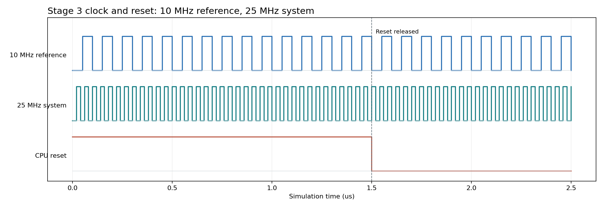

**时钟与复位。** `clk_ref` 是 10 MHz 参考时钟，`clk_sys` 是 testbench 中功能性 PLL 模型产生的 25 MHz 系统时钟。板级复位 `i_rst` 在约 1.5 微秒解除，随后 SoC 才开始总线事务。这张 RTL 图仅证明仿真模型的时序关系，不能测量真实 PLL 的锁定时间、抖动或实板时钟质量。

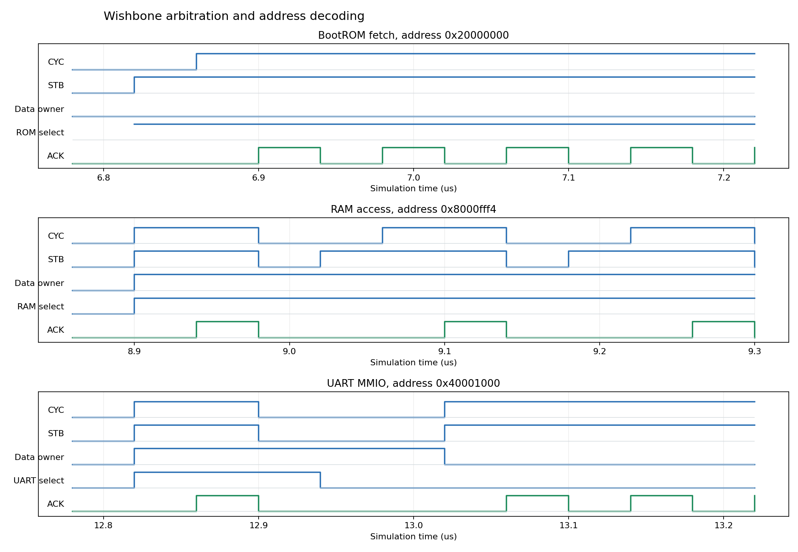

**Wishbone 地址译码。** 三个窗口分别放大 BootROM `0x20000000`、RAM `0x8000fff4` 和 UART `0x40001000` 附近的访问。主设备置 `CYC/STB` 请求时，对应的片选升高；从设备完成访问后给 `ACK`。标题中的地址是该窗口选中的起始访问，不表示窗口内每一次 ACK 都对应同一个地址。它说明访问被路由到不同外设，读写内容是否正确仍由 testbench 断言检查。

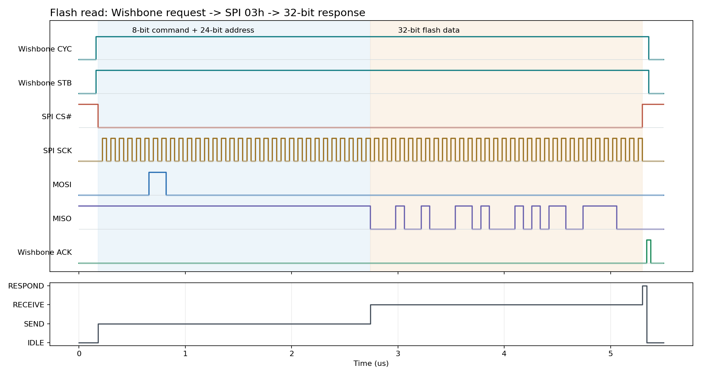

**Flash 读桥。** `Wishbone CYC/STB` 表示 CPU 一侧发起读请求；`SPI CS#` 拉低后，`SCK` 逐位送出 `03h` 读命令和 24 位物理地址，再从 `MISO` 收回 32 位数据。下方状态依次是空闲、发送、接收、应答。`ACK` 表示这笔总线读操作完成；它不是 SPI 每个时钟都产生一次的确认。该 testbench 的桥接检查通过。

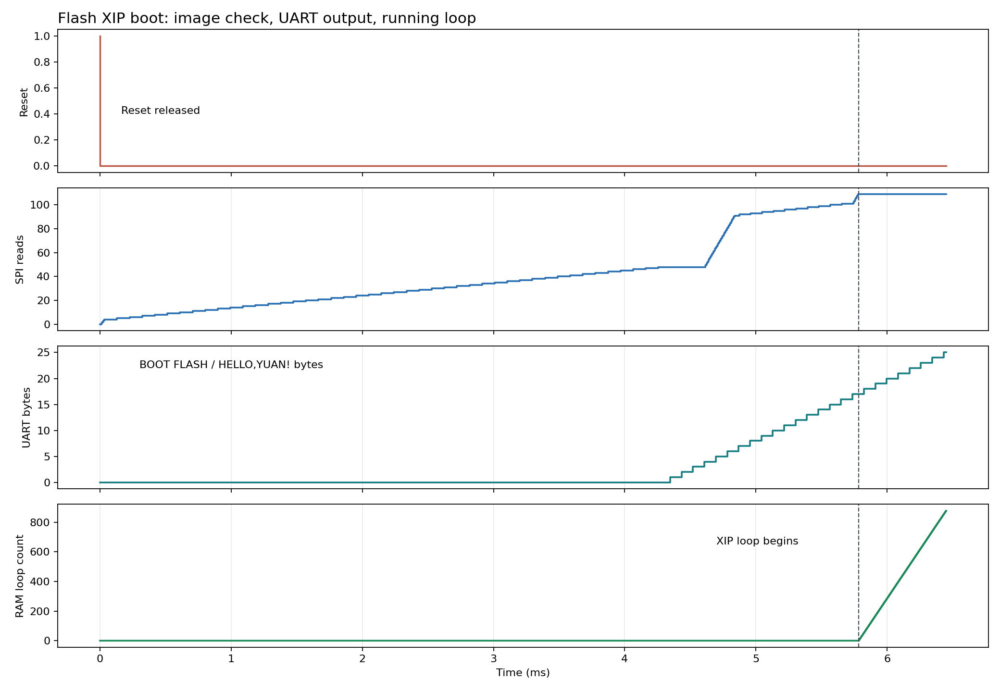

**Flash 启动。** 复位解除后，SPI 读计数先增加，表示 BootROM 读取并校验 XIP 镜像，随后 UART 字节数增长，表明启动文字经发送线输出；到约 5.78 ms 时，RAM 中的应用循环计数开始持续增加。图中展示的是有效镜像路径；同一 testbench 还测试 CRC 错误和无效头回退 UART，但没有把那些情形挤进这张图。

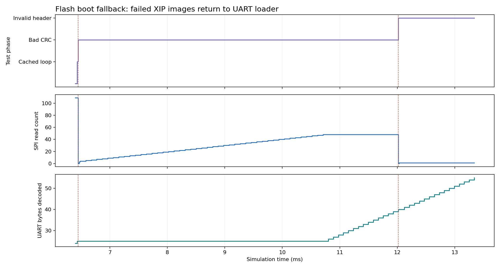

**Flash 错误回退。** 有效镜像测试后，testbench 先破坏 XIP 内容的 CRC、执行板级复位：SPI 读计数从零重新增加，说明 BootROM 再次检查镜像；UART 解码字节数随后增加，且字节级断言核对 `BOOT UART 64K`。第二次改坏头部再复位，几乎不再读取应用内容，仍回到 UART 加载器。上方 `Test phase` 是 testbench 标记，不是 FPGA 的硬件状态寄存器；红虚线标示两次测试复位附近。

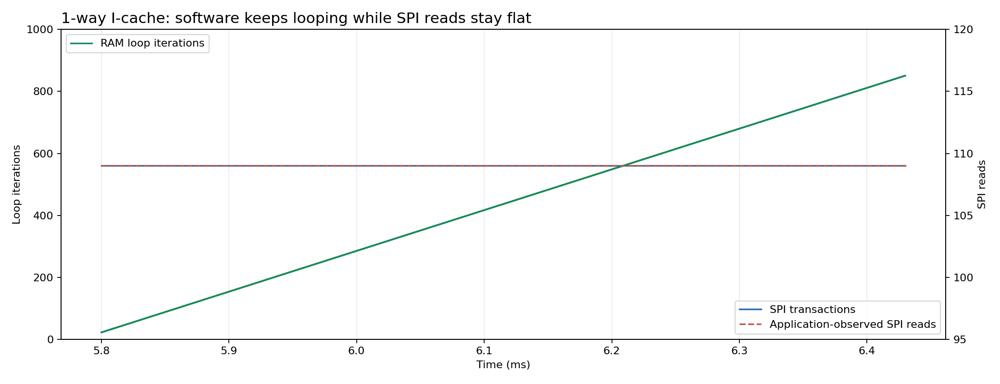

**1-way 缓存。** 左轴的循环次数持续增长，右轴的 SPI 事务计数及应用观察到的读数在所选时间窗内保持水平。这说明此处循环仍在执行，但这段时间没有反复从 Flash 补取同一批指令；它支持“该循环缓存命中”，不代表整个程序永不访问 Flash。

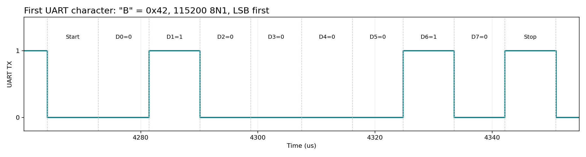

**UART 串行发送。** 线空闲为高，起始位为低；数据按低位在先依次为 `0,1,0,0,0,0,1,0`，即 `0x42`、字符 `B`；最后是高电平停止位。每位约 8.68 微秒，对应 115200 波特率。这里看见的只是 `BOOT FLASH` 首字节，不是全部文本；完整文本仍由 testbench 的串口解码断言核对。

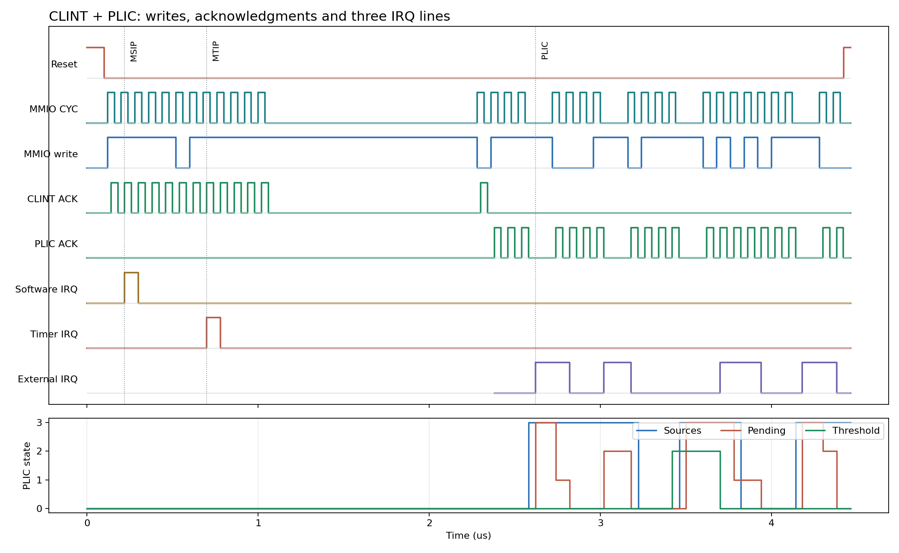

**中断控制器。** `MMIO CYC/write` 是 CPU 侧寄存器访问，`CLINT/PLIC ACK` 是外设应答；软件中断 `MSIP`、定时器中断 `MTIP` 和 PLIC 外部中断分别在约 0.22、0.70、2.62 微秒首次出现。下方的 sources、pending、threshold 帮助解释外部中断为何被接受或屏蔽。此图来自 CLINT/PLIC 独立测试，不能替代完整 FreeRTOS 调度波形。

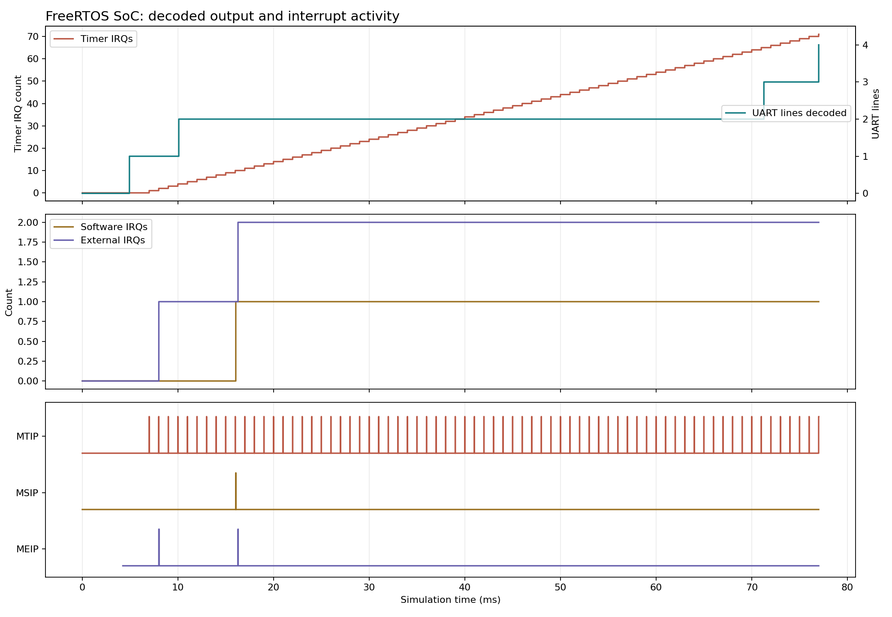

**FreeRTOS 整机总览。** 与上图的单元测试不同，这次是生成的真实 RISC-V CPU 执行官方 FreeRTOS 内核的完整 RTL 仿真。约 77 ms 的运行里，定时中断持续出现，串口解码完成四行输出；软件中断一次、外部中断两次，底排给出 `MTIP/MSIP/MEIP` 电平。最终 testbench 输出 `FREERTOS PASS tick=66 switches=102 queue=14 msip=1 plic=1 uart=1`。图中的定时 IRQ 上升沿累计 71 次，与应用报告的 66 个 RTOS tick 口径不同，不能把两者直接当成同一个计数器。图没有逐条显示任务上下文保存的内部寄存器；抢占、寄存器、队列等结论来自应用断言和完整仿真日志。

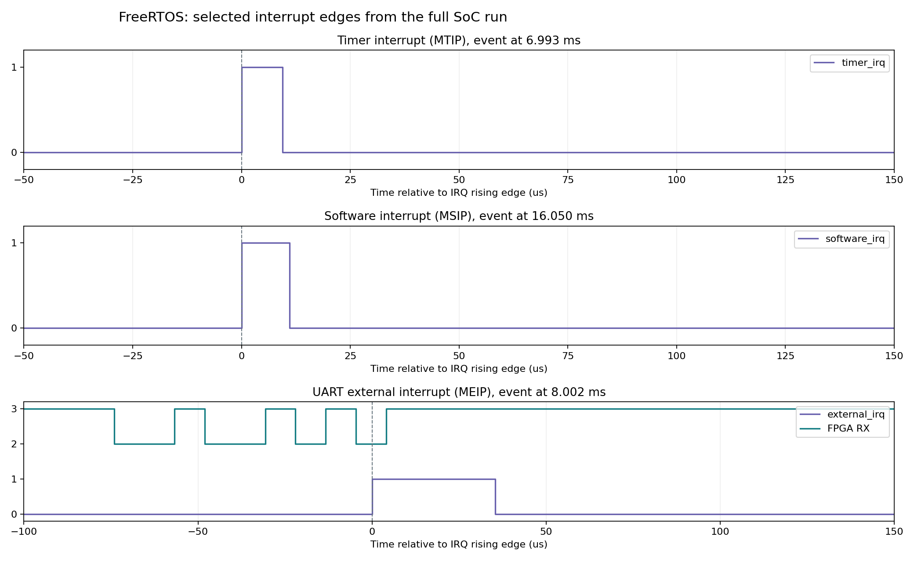

**中断边沿放大。** 第一排定时 IRQ 约在 6.993 ms 拉高，第二排软件 IRQ 约在 16.050 ms 拉高；均在处理后回落。第三排显示 testbench 向 FPGA RX 送入一个 UART 字节，第一笔外部 IRQ 约在 8.002 ms 到来；RX 波形按显示需要抬高两格，不是 2/3 V 的模拟电压。约 16.282 ms 的第二笔外部 IRQ 来自后续测试事件，不应误说成第二个 UART 字节。这里的相对时间 0 是所选 IRQ 的上升沿。

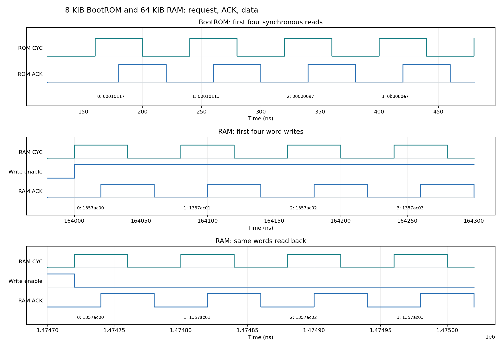

**同步存储器。** 上图前一排是 BootROM 连续读取前四个 32 位字，`ROM CYC` 提出请求，`ROM ACK` 表示同步读出的数据有效；数字 `0..3` 是**字地址**，旁边的十六进制数是读到的指令字。中间一排用 `Write enable=1` 把 `0x1357ac00..03` 写到 RAM 字地址 `0..3`，下一排关闭写使能并逐字读回相同数值。图只放大前四笔交易；该 testbench 另外检查全部 8 KiB ROM/64 KiB RAM、字节写掩码、存储体边界与复位保持，不能把截图当作全空间可视化。

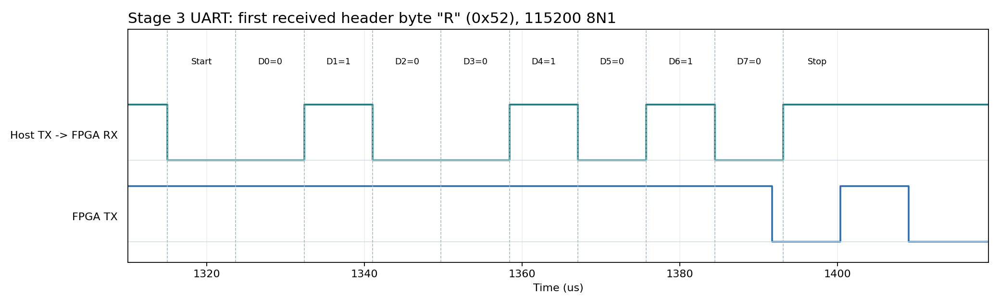

**串口下载入口。** 电脑的 TX 线接 FPGA 的 RX，这里的 `rx` 是**站在 FPGA 一侧命名**。图中第一个下载头字节按低位在先为 `0,1,0,0,1,0,1,0`，即 `0x52`、字符 `R`，是 `RV32` 头的开头；起始位为低、停止位为高。每位约 8.68 微秒。图中稍后的 `FPGA TX` 跳变是板端回复的一部分；完整下载、CRC 拒绝、RAM 跳转仍由 testbench 的字节级断言判定，单凭一个字节波形不能证明全流程。

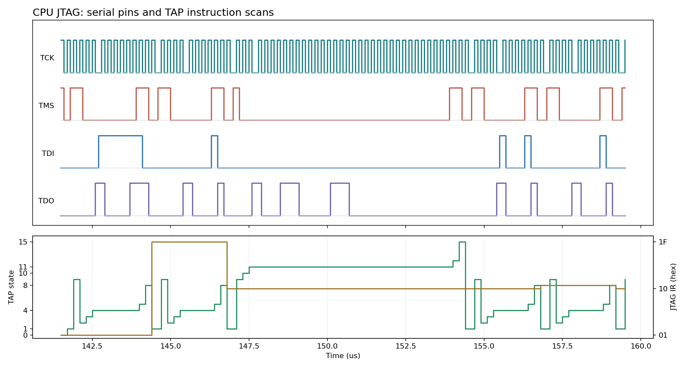

**JTAG TAP。** `TCK` 是移位时钟，`TMS` 决定 TAP 状态转移，`TDI` 是调试器送进 FPGA 的位，`TDO` 是 FPGA 返回的位。下方绿线给出 TAP 状态编码，例如 `1=IDLE`、`4=IR_SHIFT`、`8=IR_UPDATE`、`10=DR_CAPTURE`、`11=DR_SHIFT`；黄线为当前指令寄存器 IR 的十六进制值（可见 `1F`、`10`、`11` 切换）。这段信号来自 OpenOCD 的 remote-bitbang **RTL 仿真**；该仿真还核对了从模拟 Flash 窗口经 CPU JTAG 读回的应用字节，不能把图当成真实调试器的电气波形。

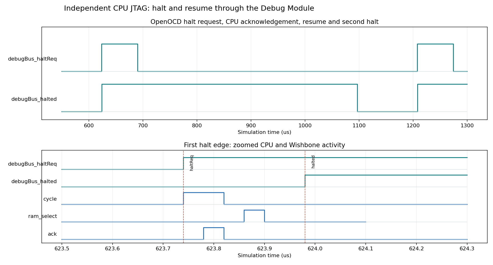

**CPU 暂停/恢复。** 这张图来自独立调试 CPU 的 OpenOCD `core` RTL 仿真，不是前一张 Flash 只读 TAP 测试。约 623.74 微秒，Debug Module 提出 `haltReq`；约 623.98 微秒，CPU 的 `halted` 变高。之后 CPU 曾恢复运行，约 1208.38 微秒再次进入暂停。下方放大了第一次暂停附近的 `CYC`、RAM 地址命中和 `ACK`；总线可能有在途活动，不能仅凭 `ram_select` 为高就说调试器此刻写了 RAM。该次 core 验证还通过了 RAM 边界、寄存器、单步、复位保留 RAM 和硬件断点。

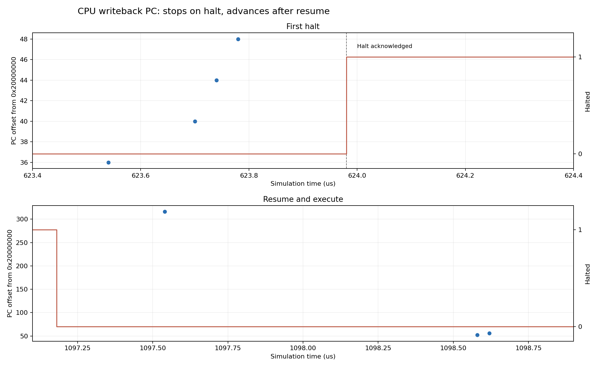

**CPU 执行地址。** 蓝点只表示流水线 `writeBack valid=1` 时的 PC，纵轴是相对 BootROM 基址 `0x20000000` 的**字节偏移**，不是指令条数；红线是 `halted`。首次暂停确认前，仍可看到几笔有效写回；约 623.98 微秒进入暂停后，所选窗口不再出现新的有效写回点。约 1097.18 微秒恢复后，有效 PC 再次出现。流水线无效周期里 PC 寄存器可能仍有数值，所以作图时不能不看 `valid` 就称 CPU 在执行。后续单步的 PC 结果另由 OpenOCD 测试断言核对，不能仅凭这张图推断每条指令的语义。

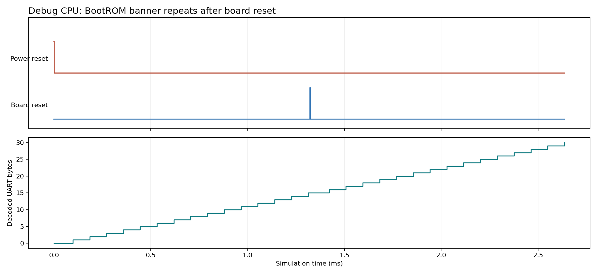

**调试版 BootROM 复位。** 初次释放电源复位后，UART 解码字节数从 0 增至 15；约 1.32 ms 施加一次很短的板级复位，同一位流再次执行 BootROM，字节数增至 30。字节级断言确认两次都是 `BOOT UART 64K` 横幅；曲线只画累计字节数，不把两次打印误当成软件应用已运行。

复现主路径时，在项目根目录的 PowerShell 中按需要运行以下命令。`-Waves`/`-Trace` 才会录制波形；**不带 `-Adapter`，只接 RTL 仿真，不会操作实板**：

```powershell
.\script\run_flash_sim.ps1 -Waves
.\script\run_flash_jtag_sim.ps1 -Waves
.\script\run_stage3_sim.ps1 -Test memory -Waves
.\script\run_stage3_sim.ps1 -Test smoke -Waves
.\script\run_rtos_sim.ps1 -Test interrupts -Waves
.\script\run_rtos_sim.ps1 -Test system -Trace
.\script\run_debug_sim.ps1 -Test uart -Waves
.\script\run_debug_sim.ps1 -CompileOnly -Test remote
.\script\run_debug_validation.ps1 -Test core -Waves
python -m pip install -r .\script\waves\requirements.txt
python .\script\waves\render.py
.\script\waves\export_wlf.ps1
.\script\waves\run_modelsim_flash_read.ps1
```

命令耗时差别很大，完整 FreeRTOS SoC 和独立 CPU 调试仿真尤其较慢；已录好的 VCD/事件文件仍在本地 `build/` 时，只需运行绘图和 WLF 转换命令（首次绘图前安装 Python 依赖）。最后一条 ModelSim 命令是**独立复测** Flash 读桥，不是生成前面十六张图的必需步骤。上述输出在 `build/`，不随 Git 提交。完整 RTOS 的 `-Trace` 保留关键电平和计数变化，**不是** CPU 所有内部寄存器的全量 VCD。

**ModelSim 这几个命令各做什么？**

| 名称 | 本项目中扮演的角色 | 类比时要注意 |
| --- | --- | --- |
| `vlib` | 新建保存编译结果的 `work` 库 | 像建一个编译输出目录，不是创建 FPGA 里的 ROM |
| `vlog` | 把 Verilog RTL 和 testbench 编译进库 | 检查语法并形成仿真模型，不是 TD 的综合/布局布线 |
| `vsim` | 加载模型、推进仿真时间并执行 testbench | 它在电脑上计算电路行为，不是给开发板下载位流 |
| `log -r /*` | 让 ModelSim 录制所选层次下的信号变化 | 不加日志记录也能仿真，但生成的 WLF 可能没有想看的信号 |
| `run -all` / `$finish` | 持续运行直到 testbench 自己结束；`$finish` 是其正常终点之一 | 正常结束还需结合 PASS 和错误输出判断，不能只看进程退出 |
| `-novopt` | 禁用这版 ModelSim 载入设计时卡住的优化流程 | 可能降低速度；它不改变 RTL 的目标功能，也不是所有版本都必需 |
| `-view` | 只打开已有 WLF 数据集，不重跑 RTL | 能打开 WLF 不等于 ModelSim 曾直接执行该 testbench |

目前有两条不同的波形来源，答辩时不能混说：

```text
主要图：Icarus 编译/仿真 RTL -> VCD 或 FreeRTOS 事件轨迹 -> 画成 PNG
                                             \-> 转成 WLF，供 ModelSim 读取
单项复测：ModelSim vlib -> vlog -> vsim -novopt 直接运行 Flash 读桥
                                             \-> ModelSim 直接录制 WLF
```

需要用 ModelSim 查看时，运行 `script/waves/export_wlf.ps1`，它把九份录制转换到 `build/waves/wlf/`。本机 ModelSim 10.1c 的 `vcd2wlf` 转换成功，`wlf2vcd` 反向核对的关键电平及结束时间一致，`vsim -c -view <WLF>` 也已成功打开数据集。最初直接用 `vsim` 执行 testbench 停在 `Design is being optimized...`；`vsim -c -lic_noqueue -novopt` 避开该优化流程后，`run_modelsim_flash_read.ps1` 在独立库中编译并实际跑完 Flash 读桥测试，输出 `PASS flash read-only Wishbone SPI bridge`，由 ModelSim **直接录制** `build/waves/modelsim/flash_read_direct.wlf`。该 WLF 非空，反向导出的 VCD 标有 `ModelSim Version 10.1c` 和真实电平变化。Intel 的[旧版 ModelSim 优化卡住说明](https://www.intel.com/content/www/us/en/support/programmable/articles/000084824.html)也建议用 `-novopt`，但本文的结论主要依据本机复现：目前只证明这个最小 testbench 由 ModelSim 直接完成，**不**证明全部十六张图都由 ModelSim 重跑，也不等于实板采集或 GUI 人工检查每一条信号。

## 13. 看代码时按什么顺序，改功能时该改哪里

### 13.1 一条不容易迷路的阅读路线

| 顺序 | 文件或函数 | 阅读时回答这个问题 |
| --- | --- | --- |
| 1 | `rtl/stage3/stage3_rtos_top.v` 的两个模块 | 板级输入如何接入？CPU 的两个总线口和三路 IRQ 接谁？ |
| 2 | `rtl/stage3/stage3_memory.v` | ROM/RAM 怎样映射到实际 BRAM，访问何时应答？ |
| 3 | `rtl/common/uart_wb.v` 与 `uart_rx.v/uart_tx.v/fifo.v` | 软件访问哪个寄存器会进队/出队，字节怎样变成线路位？ |
| 4 | `fw/stage3/bootrom.c` 的 `boot_main` | 下载头验证什么，何时允许写 RAM 和跳转？ |
| 5 | `script/uart_upload_stage3.py` 的 `packet` 及共用 `transfer` | 电脑怎样补齐、算 CRC、等待并核对应答？ |
| 6 | `fw/rtos/start.S`、`app.ld`、`FreeRTOSConfig.h` | 应用入口、栈、BSS、mtvec 和内核参数怎样准备？ |
| 7 | `fw/rtos/main.c` 的 `main/producer/consumer/monitor` | 任务怎样创建，如何阻塞和验证，而非顺序执行？ |
| 8 | `rtos_clint.v/rtos_plic.v` 与应用 ISR | 硬件状态如何变为中断，ISR 怎样清除并通知任务？ |
| 9 | `fw/rtos/registers.S` 与官方 `portContext.h/portASM.S` | 哪些值可能被切换破坏，保存与恢复在哪里发生？ |
| 10 | `tb/stage3/`、`tb/python/` 与验收脚本 | 哪个检查实际覆盖了哪条结论，哪里仍没有证据？ |

其中官方 port 位于本地依赖目录，不随本仓库直接提交；先运行 bootstrap 才能看到。CPU 生成的巨大 Verilog 不适合作为初学者第一站，先读较短的 Scala 配置，理解选了什么功能，再按问题追到生成 RTL。

### 13.2 三个具体的“我想改一下”例子

**例一：把 UART-only 的输出从 APP 1 改为温度文本。**主要改 `fw/stage3/app.c`，重新编译并上传应用；只要 CPU、外设和 BootROM 协议不变，不需要因此修改电路。若只是示例常量，需明确它不是传感器实测温度。

**例二：让 RTOS 每 100 ms 处理一次业务。**在任务中按当前 1000 Hz tick 安排周期，通常用 `pdMS_TO_TICKS(100)` 表达意图；新加任务还要检查栈、堆、优先级和共享 UART 访问。不能只把 tick 配置改成 10 Hz 来“让任务每 100 ms 跑一次”，那会影响整个内核的时间粒度。

**例三：增加一个 GPIO 输入并用中断唤醒任务。**需加 GPIO RTL、总线地址译码、引脚约束、外设状态/清除寄存器，并扩展中断控制器容量和软件 ISR；当前 PLIC 只有两源，不能假设直接写 ID3 就会工作。随后添加外设 RTL 测试、整机测试和实板验证。这是硬件加软件的改变，需要新位流。

这三个例子说明：功能需求不同，修改层次不同。总线地址、硬件寄存器、链接脚本和软件驱动是契约，改变其中一端时要同步检查另一端。

## 14. 给答辩准备的讲述和自测

### 14.1 用三分钟按因果顺序讲项目

> 我们在安路 EF2 FPGA 上集成了基于 VexRiscv 的 RISC-V SoC，重点是把固定硬件与可更新软件分开。位流定义 CPU、8 KiB BootROM、64 KiB RAM 和 UART 等电路；C 程序由交叉 GCC 编译为机器指令，经 UART 放入 RAM 后由 CPU 执行。
>
> CPU 复位先到 BootROM。引导程序检查下载头的标识、长度、入口和 CRC，再跳到 RAM 的启动汇编；启动汇编设置栈、清 BSS，才进入 main。Wishbone 负责 CPU 与存储/外设的读写，地址译码选择目标，UART 不是片内总线本身。
>
> 实板已验证两份约 42 KiB 的不同 C 应用、真实 newlib 格式化输出和部分 RAM 读写。ROM/RAM 还通过完整空间的功能模型测试，TD 在当前约束下没有报告 setup/hold 违例。这些证据各有范围，没有拿模型覆盖当作实板全地址穷举。
>
> 为运行官方 FreeRTOS V11.1.0，我们增加机器模式陷阱支持、64 位 mtime 定时器和双源精简 PLIC。每 1 ms 的节拍驱动抢占，官方移植层保存任务上下文；六个测试任务验证寄存器、临界区、队列和 ISR 通知，真实 UART 输入能唤醒任务，后续心跳持续增长。
>
> 另外独立 JTAG 方案通过普通 I/O 接 CPU 的标准调试 TAP。2026-10-18 已用 IoTelic FT2232HL 和 OpenOCD/GDB 在真实 FPGA 上完成全 64 KiB 下载/逐字节读回、ELF、指令与源码单步、软硬件断点、复位和代码重载检查；此前仿真与 TD 也已通过。
>
> Flash 变体把 FPGA 位流和 XIP 应用分别写入片内 Flash 的配置区与 MCU 用户区。2026-10-23 的合并版进一步让同一 CPU 运行 FreeRTOS、从 Flash XIP 取指并通过独立 CPU JTAG 调试；合并版 64 KiB RAM 下载/逐字节读回、源码调试和复位恢复已在实板通过。用户取下外接 IoTelic CPU JTAG 五线、未用 TD 下载后，COM3 在一次会话中捕获三次分别由用户操作的板载 Type-C 断电重上电，各次均有 BootROM、FreeRTOS 自检和三条递增心跳；之后 120 秒连续运行也通过。PotatoPie V3.0 的 AL-Link Mini 是板载器件，Type-C 供电时它仍在板上，不能称“板上完全没有调试器”。旧独立变体保留用于定位问题；早前的超时和 USB 间歇失联记录仍保留，长期可靠性尚不能由这几次试验证明。

### 14.2 常见问题，先自己说一遍再看答案

**问：系统总线到底是什么，UART/JTAG 算不算？** 片内 CPU 访问存储器和外设使用 Wishbone；UART 是串行通信外设，JTAG 是配置/调试信号协议。三者处于不同层次，不是三选一的同类总线方案。

**问：只有 1 KiB 就不能写 C 吗？** 可以写很小的受限 C，但难以放下通用库和较复杂应用。1 KiB 是历史 Stage 2 的容量，当前是 64 KiB RAM；容量扩大后仍要算代码、BSS、堆和栈，不能说任意 C 程序都能运行。

**问：为什么同时需要 BootROM 和 RAM？** BootROM 保留复位时可靠可执行的下载程序，RAM 容纳可更新应用和运行数据。应用传输时，CPU 在 ROM 执行加载器，经数据总线向 RAM 写字节；完成后才从 RAM 取应用指令。

**问：RAM+ROM 的地址是链接器还是硬件决定？** 硬件译码先决定哪些地址确实存在、连到哪个模块；链接器让软件放到这些地址。两者必须一致，只改链接脚本不会凭空变出一块 RAM。

**问：为什么 BIN 最大 60 KiB，物理 RAM 却有 64 KiB？** 顶部 4 KiB 留给主程序/ISR 栈；而且 BIN 不含完整 BSS、任务堆栈需求。60 KiB 是载荷上限，不是任何 60 KiB 程序都一定能运行的保证。

**问：1 ms tick 能保证所有任务在 1 ms 内完成吗？** 不能。tick 只是时间基准和调度机会，实际响应取决于优先级、执行时间、临界区和中断负载；本项目未给出最坏实时延迟保证。

**问：任务切换就是 CPU 复位吗？** 不是。切换保存/恢复不同任务的寄存器、栈和返回位置，让它们继续原来的执行；复位则按复位入口重新启动系统。

**问：timer、软件中断、PLIC、软件定时器是同一个东西吗？** 不是。mtime 比较产生机器定时中断；msip 产生机器软件中断；PLIC 汇聚外部中断；FreeRTOS 软件定时器是内核提供的另一项功能，当前未启用。

**问：项目是否实现了操作系统？** 可以说“移植并实板运行官方 FreeRTOS 内核”，不能说“自行研发了一个通用操作系统”。没有 Linux、MMU、任务地址隔离、文件系统和网络栈的本轮验证。

**问：如何证明不是写死 PASS？** 应用先检查计数、寄存器、临界区和队列断言；主机还发送真实 RX 输入，要求 ISR 通知后的任务应答，再读三个增长心跳。解释这些检查机制比单独展示一行 PASS 更有说服力。

**问：掉电后还能运行刚才下载的应用吗？** 要区分路线：UART/RTOS 下载到 RAM 的应用掉电后不保留；Flash 变体已把位流和 XIP 应用持久写入片内 Flash。用户确认开发板重上电且未用 TD 下载后，CPU 仍在 XIP 地址执行。调试线仍连接，完全独立供电和同步串口启动日志尚未验收。

**问：位流烧进 Flash 后，为什么还要烧 C 程序？** 位流只定义 CPU、BootROM、总线和外设；C 程序编译后的机器指令是另一份内容。本项目把两者放在同一 512 KiB Flash 的不同区，上电先配置 FPGA，再由 BootROM 校验并跳到 XIP 应用。

**问：我们的工作和上游库的边界在哪里？** CPU 核心来自 VexRiscv，调度内核和 RISC-V port 来自 FreeRTOS；本项目完成生成配置、SoC 互连、存储映射、加载协议、外设/中断、板级移植和验证。答辩时把集成工程讲清楚，比把上游成果说成从零自研更准确。

### 14.3 五个纸上练习

1. CPU 读 `0x8000e004` 会去哪里？答：RAM 最后一个 8 KiB bank，区内偏移 4 字节，需等 RAM 应答。
2. 向 `0x20000000` 写数据会怎样？答：命中 ROM 但写禁止，顶层返回总线错误，不会改写 BootROM。
3. 程序 BIN 4 KiB，却有 58 KiB BSS，还能直接运行吗？答：不能只看 BIN；加上代码、堆和栈会超过当前布局，需让链接检查并重新设计。
4. UART FIFO 中已有一个字节，却只写 PLIC complete，不读 RX，会怎样？答：外设 IRQ 仍高，gateway 重新开放后可能再次 pending，形成反复中断。
5. 不用主动 delay 的 spin0/spin1 都在增加计数说明什么？答：结合 tick、相同优先级和上下文校验，支持“发生抢占式轮换”的结论，不是证明存在两个物理 CPU。

## 15. 历史、局限与进一步查证

### 15.1 为什么保留 Stage 1/2

Stage 1 用极小的简化 CPU 验证时钟、UART、ROM 初始化与板级起跑，不是普通 C 的完整平台。Stage 2 换成完整 VexRiscv，以 1 KiB ROM/1 KiB RAM 和 896B 载荷验证小程序加载，同一位流仅按 SW2 换程序有历史实测。Stage 3 才扩为 8 KiB ROM/64 KiB RAM，并分出 UART-only、独立 JTAG、RTOS、Flash XIP 四条路线。

分阶段的意义是每次只扩大一部分问题范围，出错时容易定位；不是说当前系统还受 Stage 1 简化指令集或 Stage 2 896B 载荷限制。早期实验文件保留可追溯性，但禁用的私有 JTAG 探测入口、`*.invalid_bit` 和无依据的时序屏蔽都不应拿来继续板测。

### 15.2 不应超过证据范围的几件事

- UART-only 实板测试覆盖实际程序、数据、上部 14 KiB 测试区及栈，不是实板全 RAM 地址穷举；完整空间覆盖来自功能模型。
- Stage 3 仅 SW2 换载、最大 60 KiB BIN 尚未单独实测；已有配置后的两份应用成功，不能替代这两项。
- 两项历史长 UART 仿真曾因耗时终止，未完成，不计通过；这与已完成的 RTOS 整机 RTL 仿真是不同测试。
- FreeRTOS 未验证长期稳定、最坏中断延迟、极限负载、嵌套中断、低功耗和软件定时器；当前任务也无内存保护。
- 独立 CPU JTAG 实板已在本模块、100 kHz 下通过完整验收，但未覆盖其他适配器、高速或长期稳定性；复现仍需正确电平/接线。仿真结果、EF2 配置 ID 或 AL-Link 配置成功不能单独作为 CPU 调试证明。
- Flash 变体的板上供电重插测试仍接着调试线；首次重启后的 JTAG 探针曾返回全 1，后续正常的原因尚未定位。不要把它说成已完成完全无调试线、长时间或多次冷启动可靠性测试。
- CRC、UART 下载和调试接口没有提供认证/保密保证；不是可直接用于有安全要求产品的启动链。

### 15.3 想查细节，读哪份资料

| 资料 | 用途 |
| --- | --- |
| [根 README](../README.md) | 当前总览、环境路径、目录与操作入口 |
| [AGENTS.md](../AGENTS.md) | 后续工作的方向、验证顺序和硬件安全边界 |
| [Stage 3 UART 说明](stage3/README.md) | 地址、裸机构建、上传复现 |
| [UART 实板验收](stage3/HARDWARE_VALIDATION.md) | 两应用、格式化输出和错误帧测试证据 |
| [FreeRTOS 说明](stage3/FREERTOS.md) | RTOS 版本、布局、复现、资源、哈希与实板记录 |
| [独立 JTAG 说明](stage3/JTAG_DEBUG.md) | 调试协议、仿真、接线电压、实板验收与复现流程 |
| [Flash XIP 说明](stage3/FLASH_XIP.md) | 片内 Flash 分区、上电流程、1-way 缓存及实板证据 |
| [CPU 来源说明](../rtl/cpu/README.md) | 上游版本、生成依赖和不同 CPU 的边界 |

最后应能用自己的话串起来：**FPGA 位流搭出 SoC；CPU 复位执行 BootROM；UART 路线把应用送入 RAM，Flash 路线从持久存储的 XIP 应用取指；Wishbone 支持取指和外设访问；timer 与中断让官方 FreeRTOS 保存上下文并调度任务；JTAG 是另一条观察和控制程序的调试路径。**理解这条因果链，比背缩写更重要。
