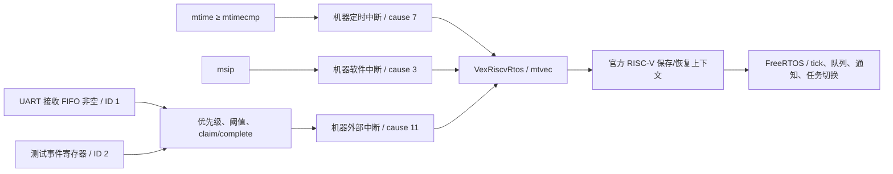

# FreeRTOS：任务调度、定时器和中断

更新：2026-10-15。本轮使用官方 **FreeRTOS-Kernel V11.1.0**，移植层为 `portable/GCC/RISC-V`，不是自己写的调度器。新增 `stage3_rtos_top` 和 `VexRiscvRtos`；旧 UART-only 和独立 JTAG 工程分别保留。**完整 RTL、TD 时序和实板 FreeRTOS 运行均已通过。**

## 为什么需要改硬件

原系统能顺序执行一个 C 程序，但三路 CPU 中断都接 0，旧 CPU 的 `ecall` 和陷阱配置也不适用于 FreeRTOS。操作系统需要定时打断任务、保存其寄存器和栈，再恢复另一个任务的上下文。仅编译内核不会让这些硬件能力自动出现。

本配置运行在单核 RV32IM 的机器模式，没有 MMU、用户态、浮点或压缩指令。CPU 仍是 25 MHz、4 KiB 指令缓存、无数据缓存，ROM 8 KiB、RAM 64 KiB。CSR 支持可写 `mtvec`、`mepc`、`mstatus/mie/mip`、可读 `mcause/mhartid`、`mscratch`，以及 `ecall/mret`。



## Timer 和中断控制器

`rtos_clint` 是单 hart 的 CLINT 地址兼容实现。64 位 `mtime` 每个 CPU 时钟加 1，64 位 `mtimecmp` 达到时置位 MTIP。内核每 25000 个计数产生一拍，因此 25 MHz 对应 **1000 Hz tick（1 ms）**。FreeRTOS 的官方移植层负责更新下一次比较值、执行 `xTaskIncrementTick`，必要时切换任务。该版本关闭 tickless idle。

RV32 需要用两次 32 位访问处理 64 位时间。读取时用高-低-高并核对高字未变化；改比较值时按官方移植层的安全顺序写，避免中间值产生意外中断。软件中断 `msip` 置 1 请求、置 0 清除，独立于定时中断。

`rtos_plic` 是本项目的精简控制器，使用标准 PLIC 的单机器上下文寄存器布局：两个电平源，优先级 0..3、使能、阈值、pending、claim 和 complete。0 表示无源/禁用；更高优先级优先，同优先级较小 ID 优先。claim 消耗 pending，complete 重新开放该源的 gateway；如果外设电平仍高，会再次 pending，所以 ISR 必须先清外设再 complete。它不是完整多核 PLIC，也没有宣称规范一致性认证。

**FreeRTOS 的 tick 本身不依赖 PLIC**，定时中断直接到 CPU；PLIC 负责 UART 等外部外设的汇聚。事件寄存器是可重复测试外部 IRQ 的电路，不是将软件中断伪装成 UART 输入；UART 链路另有真实帧测试。

| 地址 | 寄存器 |
| --- | --- |
| `0x02000000` | hart 0 `msip`，bit 0 可读写 |
| `0x02004000/04` | hart 0 `mtimecmp` 低/高 32 位 |
| `0x0200bff8/fc` | `mtime` 低/高 32 位 |
| `0x0c000004/08` | UART / 事件源优先级 |
| `0x0c001000` | pending，bit 1/2 |
| `0x0c002000` | hart 0 使能，bit 1/2 |
| `0x0c200000` | hart 0 阈值 |
| `0x0c200004` | 读 claim / 写 complete |
| `0x40001000` | 原 UART 寄存器，接收 FIFO 非空产生外部 IRQ |
| `0x40002000` | 测试事件源，bit 0 写 1 请求 / 写 0 清除 |

上述外设通过原 Wishbone 地址译码访问，RAM/ROM 地址不变。所有 IRQ 状态随系统复位清除，`mtimecmp` 初值为全 1，避免上电立即产生定时中断。

## 应用与内存

官方 `port.c/portASM.S` 处理 tick、寄存器上下文和 `ecall` 主动让出。应用只实现外部/软件 IRQ 分派、板级 MMIO 和失败钩子；ISR 使用 `vTaskNotifyGiveFromISR`、`portYIELD_FROM_ISR`，不在中断里阻塞。`gp/tp` 按官方移植层假定固定，编译禁用 small-data 和链接松弛，没有线程局部存储。

示例有六个应用任务和内核 idle 任务：生产者每 5 tick 向队列递增发送序号；消费者核对顺序；高优先级 IRQ 任务等待通知；监控任务检查结果；两个相同优先级任务不调用 delay/yield，使用不同 s0..s11 值不断检查保存状态，必须依靠 tick 时间片得到执行机会。监控还检查嵌套临界区和 `ecall` 后中断状态。

内核使用 `heap_4` 的 16 KiB 静态堆，任务 TCB、任务栈和队列从中分配。应用代码、数据和 BSS（含该堆）位于 `0x80000000..0x8000efff`，顶部 `0x8000f000..0x8000ffff` 是 4 KiB 主程序栈，启动调度后复用为 ISR 栈。链接器拒绝区域重叠。该布局没有沿用旧应用的 14 KiB RAM 测试保留区，也没有独立 newlib 堆；输出采用简单 UART 文本，未宣称支持多任务 newlib `printf` 重入。

## 复现

```powershell
Set-Location 'D:\demo14_vexriscv_stage1_resource_safe_fixed'
.\script\bootstrap_debug_cpu.ps1
.\script\bootstrap_freertos.ps1
.\script\build_rtos_cpu.ps1
.\script\build_stage3_firmware.ps1  # 生成沿用的 BootROM
.\script\build_rtos_firmware.ps1
.\script\run_rtos_sim.ps1 -Test interrupts
.\script\run_rtos_sim.ps1
.\script\build_rtos_td.ps1
```

FreeRTOS 官方源码只下载到忽略的 `build/deps`；ZIP SHA256 固定为 `d5875acad2479817b35b2031dc1c7c22d100f45c7f3c9f6039cb217437a298a2`，保留上游 MIT 许可证。CPU 使用与独立 JTAG 相同的固定 VexRiscv 修订、Java/SpinalHDL/Scala 依赖；另生成不带 JTAG 的 CPU，为后续集成留下资源。新 RTOS 位流不提供上一轮的独立 CPU TAP。

输出在 `build/rtos`，包含 ELF/BIN/Intel HEX、仿真、TD 工程、报告和位流。完整仿真直接初始化功能 BRAM 并从 RAM 启动，**不把它当成 UART 下载验证**；testbench 解码真实 UART TX 并向 RX 发真实帧，外设 IRQ、CPU、内核都为真实 RTL/代码。仿真结果还依赖功能 BRAM 模型，不能代替实板时序。

实板需先独占 COM3，监听后配置易失性 FPGA 电路，不写 Flash：

```powershell
# 终端一先启动
python .\script\validate_rtos_hardware.py --port COM3
# 终端二配置已过时序门禁的新位流，触发新 BootROM 横幅
& 'D:\TD_5.6.5_Release_119.222\bin\td_commands_prompt.exe' .\script\configure_rtos_fpga.tcl
```

BootROM 通过 UART 校验 BIN 的 CRC32 后跳转，独立 JTAG 调试器不是这一流程的条件。自动验收检查完整应用断言和计数，再发 UART 输入并等待任务应答，最后核对三次心跳的 tick/队列继续增长。`hardware_validation.json` 的本地位流哈希不能独自证明板上当前配置，需要对应配置日志。本轮不使用 Flash、旧私有 JTAG 扫描或 ChipWatcher。

## 实板验收

北京时间 2026-10-15 10:40:24..10:45:00 完成 COM3/115200 验收。TD 日志显示 EF2L45B 校验成功并易失性配置新位流；上传器从新 BootROM 横幅开始传输 15544B BIN，CRC 接受后由 RAM 执行。实际串口记录如下：

```text
BOOT UART 64K
FREERTOS START V11.1.0 RV32IM 64K tick=1000Hz
CHECK preemption=1 registers=1 critical=1 queue=1 notify=1
FREERTOS PASS tick=66 switches=101 queue=14 msip=1 plic=1 uart=0
UART IRQ PASS count=1
RTOS ALIVE tick=1070 queue=214
RTOS ALIVE tick=2072 queue=415
RTOS ALIVE tick=3074 queue=615
```

首行 PASS 时尚未注入 UART 测试输入，故 `uart=0` 正常；随后上位机发送 `R`，UART 外设 -> PLIC -> ISR -> 通知 -> 高优先级任务路径输出 `UART IRQ PASS count=1`。这不是仅发送字节就计通过。后续三次心跳要求 tick 和队列计数同时增长；软件中断与事件源各一次分别已在主 PASS 前验证。

`build/rtos/hardware_validation.json` 为 `mode=hardware/status=passed`，验收程序退出码 0；串口原文、配置记录分别为 `hardware_validation.log`、`configure_hardware.log`。首次监听因尚未配置/复位未收到横幅而超时，不计作通过；以上为重新配置后完成的验收。日志与产物只保留本地，源码和本文记录可用于复现。

| 产物 | SHA256 |
| --- | --- |
| `stage3_rtos.bit` | `18d181a8813ef9c7c73831a7091b434f216fdb6909ce8e406bf19fc3b35e92fc` |
| `freertos.bin` | `8cbe4fd1375a4171d4cc0b5a7273e739a86722c0953a226219fa22cb66103f98` |
| `VexRiscvRtos.v` | `60e3373b624741bf98563e623732515bf43d93a33aa06ddb458e8339d60f36e1` |

当前 ELF 的 text/data/BSS 为 15532/12/16728B，总计 32272B；BSS 末端 `0x80007e10`，主程序/ISR 栈底 `0x8000f000`、栈顶 `0x80010000`。任务栈包含在 16 KiB 内核堆中，不与 ISR 栈混同。RAM 程序掉电不保留。本次没有烧写 Flash 或修改驱动，结束时串口已关闭。

## 已验证与边界

- CLINT/PLIC 独立 RTL 测试通过：字节掩码、MSIP、MTIP、64 位回卷、优先级、同级仲裁、阈值、claim/complete、持续电平 gateway、复位。
- 最终完整 CPU 仿真输出 `tick=66 switches=102 queue=14 msip=1 plic=1 uart=1`，实际完成抢占、寄存器、临界区、队列和三类中断；`build/rtos/simulation.log`。40 项主机测试和原完整 ROM/RAM 回归也通过。
- TD 25 MHz 时序 0 setup / 0 hold；3138/4480 LUT（70.04%）、1483/4480 寄存器、10/12 BRAM9K，64 KiB RAM 和 8 KiB ROM 保留。
- 实板 UART 下载、检查和后续约三秒持续调度已通过，不把该观察窗口当作长期稳定性认证。没有验证任意任务数量、任意中断负载、严格实时延迟上限、软件定时器或低功耗 idle；未启用嵌套中断。

独立 JTAG 仍待硬件；FreeRTOS 是新的任务，完成 RTOS 不等于完成 JTAG 实板调试。
